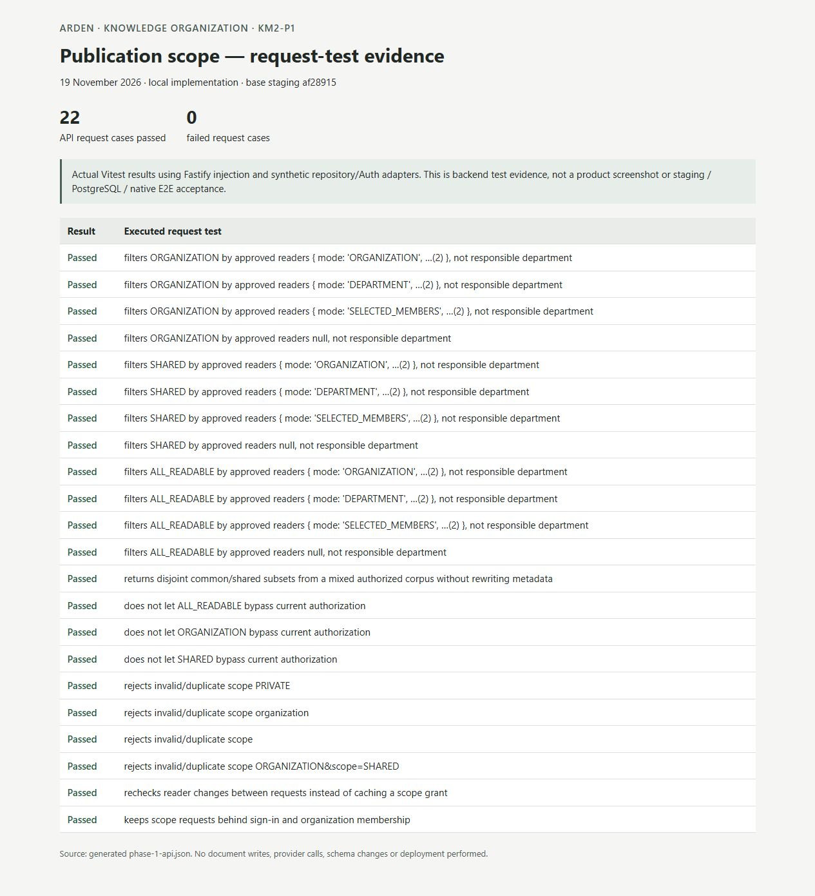
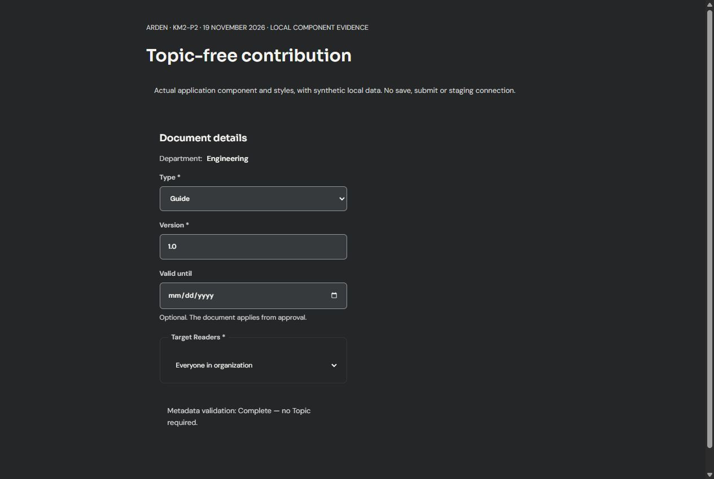
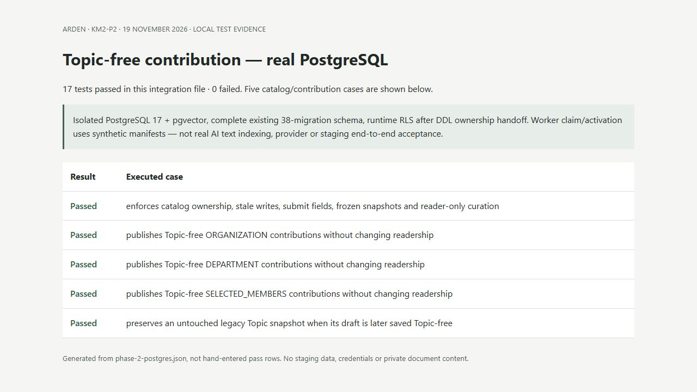
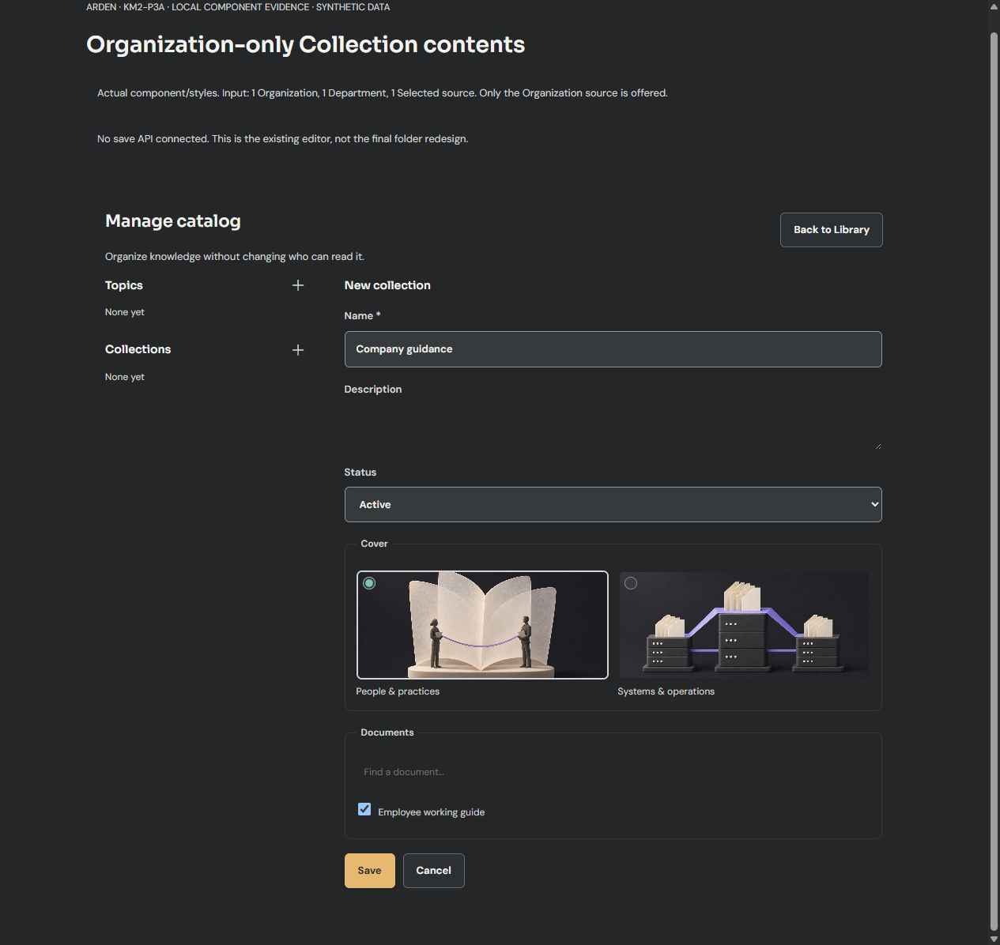
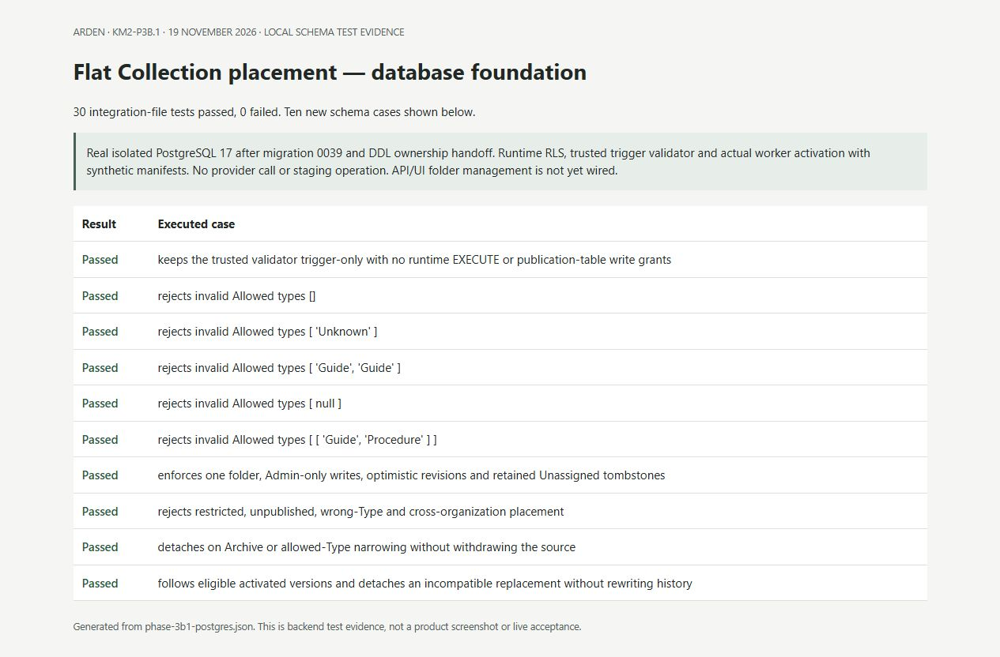
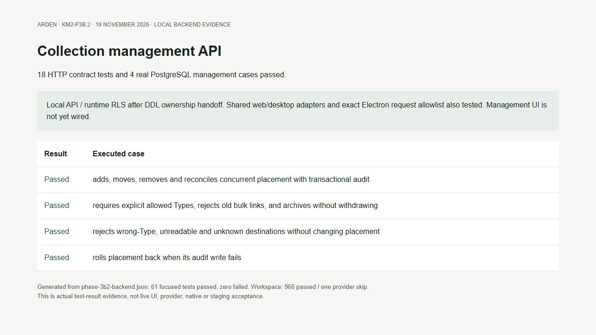
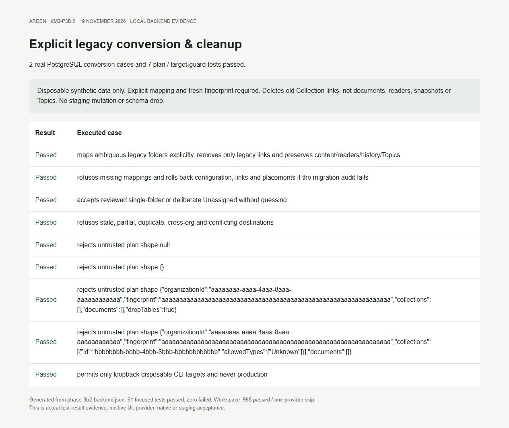

# KM2-P1 — document/readership foundation evidence

Latest checkpoint: [P3B.3 management UI](#km2-p3b3--collection-management-ui).

Date: 19 November 2026, Asia/Saigon. Tracking: ARD-77.
Implementation: local, uncommitted `feat/knowledge-scope-foundation` from staging
`af28915231817aaf6efc67c8f534b627aa45b178`; fetched main
`9fa3d34a19a559318eff87b4487f2113e6ee5a49` is unchanged.

Scope: [phased contract and entity/metadata mapping](../../engineering/knowledge-organization-phases.md).
This is the first reviewable slice, not the completed KM2 workflow or deployment.

## Delivered

- Add pure `matchesPublicationScope` and typed `PublicationScope` in domain.
- Add optional `scope=ALL_READABLE|ORGANIZATION|SHARED` on the existing authenticated
  published-list endpoint, after its current API reader check. Omitted scope is
  compatible; no response-shape change, reader widening or inference from ownership.
- Add the optional typed shared-client argument and narrowly allowlisted Electron
  query support, without changing current Home callers or AI requests.
- Preserve legacy/null metadata and readership; map existing private/contribution/
  version/submission/publication identities instead of adding a duplicate entity.

## Executed checks

| Check | Observed result |
| --- | --- |
| `pnpm typecheck` | Passed across the workspace. |
| `pnpm test` | Domain 21; API 438; UI 384; desktop 17 passed. Total 860 passed, 42 existing gated API tests skipped. Focused cases are included, not added again. |
| `pnpm test:remote` | 16 passed; synthetic transport/workflow tooling, no remote deployment. |
| `pnpm build` | API/web/desktop production bundles passed. Existing large-chunk warnings remain. |
| Focused API JSON evidence run | 22 KM2-P1 request cases passed, 0 failed; remaining tests in the file were excluded by the test-name filter, not executed by that focused run. |
| Browser evidence | Opened the generated Vitest request-results report in the in-app browser and captured the actual rendered page below. |
| Diff/docs review | Whitespace and new relative-link checks passed; inspected task-owned source, tests, contracts and evidence. |

Focused reproduction command:

```powershell
pnpm --filter @arden/api exec vitest run src/app.test.ts -t 'publication scope foundation' --reporter=json --outputFile=<local-evidence-path>/phase-1-api.json
```

The screenshot page is generated from that JSON, not hand-entered pass rows.
Raw local JSON and its small renderer are outside the public checkout. The image
contains only synthetic test descriptions and the public source baseline.

## Screenshot



This is **backend request-test evidence using synthetic repository/Auth adapters**.
It is not a screenshot of a changed Home, a live DB test, an AI-provider result,
a native Electron launch or staging end-to-end acceptance.

## Coverage and limitations

Covered: explicit Organization versus permitted Department/Selected modes,
misleading responsible department, mixed legacy corpus, null metadata preservation,
reader removal and department change between requests, suspended/foreign actors,
anonymous/foreign-organization denial, invalid/duplicate query values, unchanged
default behavior, safe public representation and no AI invocation. Web/desktop
transport and Electron policy tests cover the new client request shapes.

Not exercised: real PostgreSQL/RLS, live Supabase, actual staging row-level metadata
inventory, native Electron behavior, or the full new contribution/Collection/Home
journey. Existing jsdom canvas/scroll limitations appear during UI tests; their
passing result is not native PDF rendering evidence. No gated test is relabelled
as passed. No SQL or applied migration is modified.

Current Home remains unchanged. Topic retirement and draft-to-publication E2E are
Phase 2. Collection cardinality/Type/placement/version/archive approval is still
required before Phase 3. Exact metadata backfill mapping and operator backup/
rehearsal/migration/release are separately authorized work, not covered by this
local implementation. No data reset, reindex, paid call, push, PR, merge or
deployment was performed.

## KM2-P2 — Topic-free contribution

19 November 2026. Same local branch/baseline; Phase 1 work preserved. The
redesign-existing-projects skill guided an audit-first, minimal component change:
retain existing Island styling and exits, remove the obsolete field and catalog
dependency instead of replacing the form or navigation.

### Delivered

- Remove Topic from the actual author metadata component and submit readiness.
  No Collection selector is added. Type/Version, optional Valid until, update
  Change Note, explicit readers, content, dirty-save and pending-review rules remain.
- Accept omitted/null legacy Topic at the HTTP/domain boundary. Repository writes
  clear Topic references/labels, not Type or readers; submit no longer reads the
  Topic catalog. Untouched legacy drafts need no forced save, and frozen snapshot
  history stays unchanged. Old catalog/Home Topic surfaces are deliberately deferred.
- Extend the real PostgreSQL fixture for three Topic-free reader modes and a
  legacy snapshot, retaining the existing private-copy/readership workflow suite.
  No applied migration/schema file changes; 38-entry inventory remains unchanged.

### Executed checks

| Check | Observed result |
| --- | --- |
| `pnpm typecheck` | Passed across the workspace. |
| `pnpm test` with isolated local `ARDEN_TEST_DATABASE_URL` | Domain 22, API 489, UI 395, desktop 17 passed: **923 passed**, 1 provider-gated API test skipped. Real database suites are enabled, not counted as skipped. |
| Focused repository integration JSON run | 17 passed, 0 failed; five catalog/contribution cases shown in the report screenshot. Included in the full-suite total, not additional passes. |
| `pnpm build` | API/web/desktop bundles passed; existing large-chunk warnings remain. |
| `pnpm test:remote` | 16 synthetic tooling tests passed; no remote operation. |
| `pnpm migrations:check` | 38 unchanged entries passed. |
| Browser | Actual metadata component/styles rendered with synthetic local state; inspected Type/Version/optional date/readership, absence of Topic/Collection pickers and Department selection. Separate JSON-derived real-DB report captured. |

The task-owned loopback PostgreSQL 17 + pgvector instance uses the same pinned
image as CI. All existing migrations were applied to a fresh disposable DB, then
the reviewed ownership template transferred DDL while preserving 32 trusted
SECURITY DEFINER owners. The actual runtime/RLS and worker-contract suites ran
after this handoff. This is local verification, not a staging operation.

An initial test run exposed a fixture-cleanup query using a nonexistent column;
the query was corrected to use the existing draft lineage. An HTTP assertion
also expected undefined instead of the fake client's null. Both were corrected
and the focused/full runs above passed without weakening application checks.
Existing jsdom canvas/scroll and pg concurrent-query deprecation warnings remain;
they do not certify PDF/native behavior.

### Screenshots and limits



This is the production component/styles in a local isolated harness, **not** the
complete authenticated app or staging. The surrounding heading/status text is
evidence-only. No save/submit endpoint is connected to that harness. Organization
is an explicit fixture value, not a newly introduced product default.



This report is generated from actual `phase-2-postgres.json` results outside the
checkout. Real worker claim/complete and atomic activation use synthetic manifests;
the suite does not extract/compile/embed real PDFs or call an AI provider. Existing
tests also cover private-copy isolation, disjoint review scope and runtime
revocation. Those results do not replace authenticated browser/native acceptance.

No staging metadata inventory/backfill or migration, provider call, document
reset/reindex, push/PR/merge/deploy was performed. Legacy missing Type/Version data
and the reviewed repair mapping remain pending. Home composition, full Topic
catalog removal and Collection governance are later slices. Phase 3's placement
cardinality/Type/version/archive decisions still require approval before dependent
implementation. Code and daily Knowledge handoff remain local/unpublished.

## KM2-P3A — Organization-only Collection boundary

19 November 2026. User requests Phase 3; current main/staging fetched unchanged at
9fa3d34/af28915. The same local branch retains all Phase 1/2 work. This is a bounded
independent slice of Phase 3; outstanding folder decisions are **not** inferred
as approved by a general request to continue.

### Delivered and acceptance

- Server-side catalog list/write filtering now requires explicit approved
  Organization mode **and** existing normal current actor authorization. A source
  read by an Admin through Department/Selected membership is not common knowledge.
- The actual existing Collection editor offers only those common sources, with
  empty/no-match feedback. Existing covers and Cancel/Keep working/Discard remain.
  The redesign skill's visual audit found the general text-input width stretching
  checkboxes; a focused CSS correction keeps each checkbox beside its title.
- Existing mixed/restricted links are filtered from returned IDs/counts; an
  entirely ineligible legacy folder is hidden. An approved reader narrowing takes
  effect on the next catalog request while normal permitted reading still works.
- Legacy internal links are preserved, including on an unrelated catalog edit.
  No migration, silent primary-folder choice, legacy deletion or content/readership
  rewrite is performed. Admin-only write, stale-version and normal actor/RLS rules
  remain; authors get no upload-time Collection field.

The test fixture seeds old mixed links only in a task-owned disposable local DB;
it does not seed or modify staging. Runtime tests show an Admin actually reads the
restricted source normally before its attempted Collection placement is refused.
They also cover Member/foreign-actor write denial, common-source inclusion, legacy
projection exclusion and a real approved reader-change request.

### Executed checks

| Check | Result |
| --- | --- |
| `pnpm typecheck` | Workspace passed. |
| `pnpm test` with the isolated local DB enabled | Domain 22, API 492, UI 397, desktop 17: **928 passed**, 1 provider-gated API skip. |
| Focused repository integration file | 20 passed, including 3 new Collection cases; included in the full-suite count. |
| Focused knowledge management component file | 11 passed, including 2 new picker cases; included in the full-suite count. |
| `pnpm build` | API/web/desktop passed. Web build repeated after the checkbox-only CSS correction and passed. |
| `pnpm test:remote` / `pnpm migrations:check` | 16 tooling tests passed; 38-entry inventory unchanged/passed. |
| Actual browser component check | New collection, Name, eligible checkbox, restricted-title search, Keep working and Discard exits verified with synthetic local props. No save endpoint connected or clicked. |

PostgreSQL uses the same task-owned local instance with existing migrations and
the reviewed ownership split from P2. No ownership/RLS change is made in P3A.
Worker activation in fixtures uses synthetic manifests, not real AI indexing.
Existing pg concurrent-query deprecation, jsdom canvas/scroll and bundle-size
warnings remain; no native PDF/installer or live provider acceptance is inferred.

### Screenshot



Actual production component/styles/assets, isolated local harness. It is not the
full authenticated app, staging, or an approved final folder design. The input has
three synthetic publications (Organization, Department, Selected); only the first
is offered. Old Topics/Library labels are visible in this pre-composition editor;
Home/navigation/catalog cleanup remains deferred rather than silently renamed.

### Resume boundary

Pending P3B decisions: placement actor and one-versus-many cardinality; required
Allowed types; logical-document version-following, incompatible replacement and
Archive behavior. User-input prompts were sent; no response is assumed. Existing
many-link exact-publication storage remains unchanged. Any future migration needs
its own compatibility/inventory/rehearsal and authorized staging release.

Home Organization/Shared projections, legacy missing Type/Version inventory and
approved data mapping remain separate work. No paid calls, staging/production/Zack
operation, data reset/backfill/reindex, commit/push/PR/merge/deploy in this slice.
Knowledge and the code remain local/unpublished. ARD-77 is still In Progress.

## KM2-P3B.1 — flat-folder database foundation

19 November 2026, same local baseline. The maintainer explicitly approves the
three pending choices: one optional Collection/Admin-only placement, required
controlled Allowed types, and eligible-version following/Archive-to-Unassigned.
[ADR 0025](../../decisions/0026-flat-organization-collection-placement.md)
records approval and the compatibility boundary.

### Delivered

Forward **operator** migration 0039 adds nullable legacy Allowed types, a one-row
logical-document placement relation with same-organization FKs, retained
Unassigned revision tombstones, current Organization/Type validation and
eligibility reconciliation. Runtime cannot delete placement rows or execute the
trusted validator directly. The validator locks its eligibility inputs without
new runtime publication-table write grants; 33 trusted definers retain postgres
ownership after the reviewed DDL handoff.

Old exact-publication links remain unchanged. The old API/UI still use that
relation. This is schema foundation, **not connected Add/Move/Archive UI** or
completed Phase 3. No legacy destination is guessed, no Type/readership is changed
by placing a document, and no content/version history is rewritten.

### Executed checks

| Check | Observed result |
| --- | --- |
| Local rollback rehearsal | Apply SQL inside an intentional failed transaction; ledger stays at 38 and new table remains absent. This is not a backup/restore rehearsal. |
| Local upgrade and ownership | Task-owned disposable PostgreSQL 17: existing 38 → 39 migrations, reviewed DDL handoff, 33 trusted postgres definers preserved. Real runtime/worker tests run after handoff. |
| `pnpm test` with isolated DB enabled | Domain 22/API 502/UI 397/desktop 17: **938 passed**, one provider-gated API skip. |
| Final focused repository file | **30 passed**, zero failures, ten new P3B.1 cases. Run after refining the unpublished-source fixture; included in root counts, not additional passes. |
| `pnpm typecheck` / `pnpm build` | Workspace and API/web/desktop bundles passed. API typecheck repeated after the final test-fixture refinement. |
| `pnpm test:remote` | 16 synthetic tooling tests pass; no remote release. |
| `pnpm migrations:check` | 39 entries pass; existing migration bytes unchanged. |
| `python -m unittest discover -s deploy/release/tests` | 126 run: **119 passed**, seven platform skips. An initial definer-inventory mismatch was corrected before this passing rerun. |
| Browser evidence | Screenshot below is generated from final passing Vitest JSON; no hand-entered pass rows. |

New cases exercise trusted owner/ACLs, five invalid Allowed-type inputs (including
NULL/duplicate/multidimensional values), one-folder identity, Member/foreign denial,
atomic concurrent expected-revision writes, remove/re-add monotonicity, no runtime
DELETE, restricted/unpublished/nonexistent/wrong-Type rejection, Archive/type
narrowing, and compatible/incompatible actual activated replacements. Approved
reader narrowing is also exercised in the existing catalog workflow with a real
placement. Activation uses synthetic manifests, not a provider/indexing call.

Migration SHA-256:
`dd12318cdb9ff0a1c3da3ad02c574a88a98e21487d2b6b806d37610876301645`.
39-entry inventory fingerprint:
`2b1d249b591ef9f3f984edf7b900c2a273f1895247bd90fd05f475aa33e1402a`.

### Screenshot and resume boundary



Local backend results, not the live application or user acceptance. The raw JSON
and renderer are outside the public checkout and contain synthetic cases only.
Existing pg concurrent-query deprecation, jsdom canvas/scroll and bundle warnings
remain. No provider/native/authenticated staging E2E or full populated
backup/restore test is claimed; CI-only recovery scripts were not bypassed locally.

Next P3B.2: connect atomic management API/projections, required Allowed types,
safe stale/concurrency errors and explicit legacy compatibility/mapping. Then
P3B.3 UI/E2E, followed by Home composition and separately authorized rollout.
No staging/production/Zack write, live migration/backfill, reset/reindex, paid call,
commit/push/PR/merge/deploy. Knowledge updates remain local/unpublished.

## KM2-P3B.2 — Collection API and explicit legacy rehearsal

19 November 2026. Maintainer accepts API → explicit conversion → safe cleanup.
Same uncommitted branch from staging af28915/main9fa3d34, fetched unchanged.
[API and transition runbook](../../engineering/collection-legacy-transition.md).

### Delivered

- Configuration requires controlled Allowed types and no longer mutates links.
  Dedicated Admin-only logical placement GET/PATCH uses exact revision/ETag,
  atomic audit, safe stale/denied errors and retained Unassigned revisions.
- Catalog projects current eligible publications from new placement. Old exact
  links never silently grant or restore visibility. Admin sees empty/unconfigured
  shells for management; normal readers see active nonempty eligible folders.
- Shared web/desktop adapters validate placement replies; Electron narrowly
  permits the new request shapes. No UI controls are connected in this slice.
- Local-only conversion inventories metadata/identifiers, requires a fresh
  fingerprint and complete explicit folder/type/document destinations, preserves
  newer placements and removes only converted organization-scoped old links.
  Conversion/configuration/deletion/audit share one transaction; audit failure
  rolls everything back. No guessed primary folder or metadata repair.
- Removed obsolete runtime Collection bulk-link write/replacement/projection
  code. Retained legacy tables/Topic dependencies and frozen history; full physical
  contraction cannot run while freeze triggers/UI still depend on them.

### Executed checks

| Check | Result |
| --- | --- |
| Final workspace `pnpm test`, isolated DB enabled | Domain22/API526/UI402/desktop18 = **968 passed**, one provider-gated API skip. Repeated after final error-classification/projection assertion refinement; same passing totals. |
| Focused final backend JSON run | **61 passed**, zero failed: repository36, HTTP18, plan/guard7. Four new API-storage and two conversion cases are included, not added again. |
| `pnpm typecheck` / `pnpm build` | Workspace and API/web/desktop pass. API typecheck/build repeated after the final refinement. |
| `pnpm test:remote` | 16 synthetic tooling tests pass. |
| `pnpm migrations:check` |39 entries pass, fingerprint unchanged; 0039 SHA-256 still dd12318cdb9ff0a1c3da3ad02c574a88a98e21487d2b6b806d37610876301645. No new migration in this slice. |
| Release Python suite |126 run:119 passed, seven platform skips. |
| Browser evidence |Actual final JSON-derived API and conversion reports captured below. |

DB tests reuse only labelled task-owned PostgreSQL17 after reviewed DDL handoff.
They exercise real runtime/RLS, concurrent placement conflict, archive/current
projection, Type/readership denials, audit rollback, explicit multi-folder mapping,
stale/partial/malformed mapping rejection, history digest preservation, Topic
retention and restricted-reader denial after cleanup. Real worker activation uses
synthetic manifests; no AI/model/indexing call.

Initial conversion SQL/tests guessed an organization column on publication rows;
real DB tests rejected it. Corrected the join through shared_draft, then focused
and full suites pass. A client test initially expected header casing preserved;
corrected it to the actual normalized transport header. No application security
assertion was weakened. Recurring schema-join guidance added to code-quality docs.
Existing pg query deprecation, jsdom canvas/scroll and bundle-size warnings remain.

Final review adds positive pure/real-DB coverage retaining a newer valid folder
outside historical links and a real lock-wait/late-insert regression. Authoritative
inventory now uses Read Committed after maintenance locks, not an earlier frozen
snapshot. Final focused61, API typecheck/build and full root968 pass again after
both refinements. Counts do not increase because existing cases are extended.

### Screenshots





Backend reports, not a signed-in product UI. Fastify injection uses a controlled
store; separate PostgreSQL tests exercise the real store. This is not a combined
authenticated HTTP-to-DB/browser flow. CLI target validation and conversion module
are tested; full CLI subprocess workflow, populated backup/restore, native Electron
and staging acceptance are not claimed. Raw JSON/renderer stay outside public Git.

### Remaining and release boundary

Current management UI still sends retired bulk documentIds and lacks Allowed
types/separate placement controls. Old payloads fail clearly with409 rather than
silently applying the wrong model. Do not deploy the backend alone as finished UI.
Next P3B.3 connects that UI and tests its full user paths. Home composition remains
later. Topic/schema drop requires consumer retirement and a forward migration.

Synthetic legacy association rows were removed only inside disposable tests;
fixtures are cleaned afterward. No actual staging corpus was inventoried/mapped/
converted/deleted. No real metadata Type/Version backfill, reindex, reset, provider
call, live migration, commit/push/PR/merge/deploy. Live target authority, reviewed
mapping, backup/restore rehearsal, compatible UI and operator cutover are separate.

## KM2-P3B.3 — Collection management UI

19 November continuation on the same uncommitted staging-based checkout. Accepted
rules: [0025](../../decisions/0026-flat-organization-collection-placement.md).
This supersedes the UI-pending checkpoint above, not live cutover requirements.

Delivered shared UI:

- Collections-only management, required Name/controlled Allowed types, optional
  Description and existing cover choices. No Topic or bulk document picker.
- Unassigned and folder contents use explicit Organization publications. Individual
  Move loads the logical document's revision and offers active compatible folders
  or Unassigned; assignment does not modify content/Type/readers.
- Stale/uncertain writes require reload before another deliberate write. Background
  refresh cannot silently replace a form's editing revision. Confirmed saves are
  distinguished from a subsequent read failure; no automatic mutation retry.
- Archive confirmation states that documents return to Unassigned and stay
  published. Archived details are read-only; legacy unconfigured folders need setup.
- Cancel/dirty Discard, read-loading cancellation, mutation busy protection,
  late-response/context/role-loss handling, focus return and responsive stacking.
  The existing native confirmation fallback's focus capture/restore was corrected
  after a real Escape check found focus returning to the page body.
- Home no longer offers Topic browse/filter controls or a Topic label in the
  current reader. Frozen metadata and compatibility SQL/API remain intact.

### Verification and limits

Final root986 tests passed with the task-owned isolated PostgreSQL 17 database
enabled: domain22, API526/one provider-gated skip, UI420, desktop18. Focused29,
workspace typecheck and web/API/Electron production builds pass. Migration inventory
remains39/fingerprint2b1d249b591ef9f3f984edf7b900c2a273f1895247bd90fd05f475aa33e1402a.
No applied SQL, dependency/model or provider call changed. Existing jsdom canvas/
scroll warnings, pg query deprecation and bundle-size warnings remain.

Actual IAB checks use production components/styles and shared web HTTP client
against a volatile loopback **synthetic fixture server**, not a real authenticated
app/DB session. Observed: create, folder placement, stale412 and fresh read without
auto-retry, remove to Unassigned, Archive with contents returning to Unassigned,
Escape/cancel focus return and dirty Discard keyboard trapping. Restricted fixture
content is not rendered. Viewports1440/1024/640/320 checked; form/register at320 have
no horizontal overflow. Container-based stacking also protects narrow workspace
widths. 200% browser zoom, real Electron, assistive technology and combined signed-in
HTTP/DB E2E remain unverified, not waived by screenshots or builds.

| Evidence | SHA256 |
| --- | --- |
| [Required form](phase-3b3-form.jpg) | d2c299d5db31b2311ffcd8d20ba8fd15a723b3d41d74393e4444b3187aa1209c |
| [Folder after placement](phase-3b3-folder.jpg) | 5e1bd4e4469b5d43c0f062e1c93ff95716b0d49e123250b3862f7e6600b4731d |
| [Conflict blocks another write](phase-3b3-conflict.jpg) | 398b8256a6106f6947b38f33ecd144cb308633d3a19e4ebd496d59a89f571885 |
| [Archive confirmation](phase-3b3-archive.jpg) | 27dc4c2ffa4c12d3ed4a71dce8f57b22f28219571242208ee484d5df75ef5f9a |
| [Unassigned after Archive](phase-3b3-unassigned.jpg) | c623337b5d85c06e70fac2fb397b33cc56850e59dced07c368744a2125bad1a2 |
| [640px layout](phase-3b3-narrow.jpg) | 2f7459f49f08112b19eef15b2b501ec61db9a18f26681ec881d6233f9fb93632 |

At the P3B.3 checkpoint Home scope composition was next. P4A below supersedes that
local Home status, not the remaining release gates.
Live legacy mapping/metadata repair, protected backup/restore/cutover, physical
Topic/legacy-table contraction and release remain pending. No user/staging corpus
change, reset/reindex, commit/push/PR/merge/deploy or provider call in this phase.

## KM2-P4A — Home composition

19 November continuation, same local staging-based branch. Fetched main/staging
remain 9fa3d34/af28915. Delivered the accepted common/shared/private composition
with existing Island tokens, artwork and reader/contribution components.

- **KM2-P4A-1:** independent explicit Organization and Shared API scopes. Common
  documents are not inferred from owner department/Admin status. Legacy null-reader
  sources remain readable under Other documents, not silently migrated or dropped.
  Scope mismatch/invalid payloads fail visibly. Selected-reader names are not shown.
- **-2:** Organization Overview/All documents/Unassigned and active folder contents.
  All includes assigned and unassigned documents; Shared/Other have no Collections.
  Catalog failure/stale selection is unavailable, not a fabricated empty folder.
- **-3:** existing private-note workspace entry is capability-gated and separate
  from published sources. My Contributions/New draft/PDF exits stay available.
  Reader Back retains source/filter/search and restores the document's focus.
  Exact-version citation navigation uses the original authoritative reader path;
  Home state does not select or expand AI retrieval context.
- **-4:** loading/error/counts are per source. Failed refresh clears stale rows;
  slow Organization does not block ready Shared. Older replies/context changes are
  ignored; known-denied details remove the source and refresh authorized lists.
  Keyboard tabs skip disabled My reports; arrow/Home/End navigation is supported.
- **-5:** tests and actual local-browser observations below. These are bounded
  implementation evidence, not proof of deployed or signed-in/native behavior.

### Verification

Root1007 passed with task-owned isolated PostgreSQL17 enabled: domain22,
API526/one provider-gated skip, UI441, desktop18. Remote16 passed. Final UI441,
workspace typecheck, web/API/Electron production builds and migration inventory39
were rerun after the final reader-mode label/narrow-action fixes. Fingerprint stays
2b1d249b591ef9f3f984edf7b900c2a273f1895247bd90fd05f475aa33e1402a.
New Home suite21 cases covers the boundaries above. Existing owner-provenance
fixtures now explicitly use the legacy view rather than assume default discovery.
Existing jsdom canvas/scroll, pg query and bundle-size warnings remain.

Actual IAB exercised production components/styles/shared HTTP client against a
**volatile synthetic loopback fixture**, with that boundary visible in each image.
Observed six synthetic documents partitioned3 Organization/2 Shared/1 legacy;
folder contents2, Unassigned1, master3; Shared labels Department/Selected readers;
reader content and Back/focus; Other legacy; private edit surviving Home round-trip;
Organization outage with no stale count/rows, Shared still usable, explicit retry
recovery; End key opens Contributions. No Summary/Ask/provider invocation was made.
The fixture encodes reader content with the normal semantic-document format; it is
not an authenticated application/DB integration or a real PDF/native acceptance.

Widths1280/1024/640/320 observed. An action bar overflow at320 was corrected and
remeasured body/root320. 640 overview and1024 register were visually checked.
200% browser zoom, assistive technology, genuine Electron and signed-in combined
app/DB E2E remain unverified. Shared web/Electron compilation and adapter tests do
not replace those gates.

| Evidence | SHA256 |
| --- | --- |
| [Common overview](phase-4a-home.jpg) | 049ea83f1953f73aa3494aa17a432c1d0b8916062601549910ab01edbccf8179 |
| [Unassigned common document](phase-4a-unassigned.jpg) | 38f1a2e2d900767617e88a04697e496fb5071216d6db2fc941ec9afa76dd54d8 |
| [Shared Department/Selected](phase-4a-shared.jpg) | 118e028a254c6f9098bcc18c242f0018149c79c68482b763555b0da56f74b645 |
| [Legacy compatibility](phase-4a-legacy.jpg) | c9bebd80f4675906229d323335248aa04326b2e22735b0c25439d531f65d8d0f |
| [Private unsaved edit after return](phase-4a-private.jpg) | 917d1c1b241d267cb5c0fc9824856c77df33fce571860439e7b7336a803e350b |
| [Source outage, not empty](phase-4a-outage.jpg) | 702d21327cdcda365632e22999041e13a95889d0e7bb0e9592b2cf4d7499b95b |
| [640px composition](phase-4a-narrow.jpg) | 4f1f908ff208bd66d2ab1a281d9c0c9fb50a7b6e9a44b10a5e61e2eb8a69d431 |

No corpus reset, metadata backfill, reindex, live migration, physical deletion,
paid call, dependency/model change, commit/push/PR/merge or deploy. Remaining next
gates: reviewed live inventory/mapping, protected backup/restore/cutover and combined
web/native acceptance under separate release authority. Physical legacy/Topic
contraction follows verified consumers/provenance handling, not UI removal alone.
ARD-77 remains In Progress. Local code and Knowledge updates are unpublished.

Cleanup: agent-created browser tab closed, viewport reset, validated task-owned
loopback fixture server and labelled disposable DB stopped, not deleted. User tabs,
shared services and live data untouched. Changed owning relative links83 checked
with no missing files; Git whitespace checks pass (existing line-ending warnings).

## KM2-P4B — real HTTP integration and native boot

The final local workspace suite before staging repair passed 1,010 tests:
domain 22, API 529, UI 441, desktop 18; one provider-gated test skipped.
Workspace typecheck/build, remote protocol 16 and migration inventory 39 passed.
The new `home-http.integration.verification.ts` exercises real loopback Fastify,
signed session cookies, PostgreSQL runtime RLS, private file storage and worker
activation. Only the Auth provider and AI clients are deterministic doubles.

Three integrated cases cover private-original contribution and independent edits,
immutable submission/activation, Organization/Department/Selected scopes, denied
and cross-organization access, conditional placement/Archive, exact citations,
revocation during Summary and Q&A, sign-out and subsequent session denial. They
do not establish live Supabase, paid model quality or deployed acceptance.

The real built Electron main/preload/renderer booted against the same synthetic
local API/PostgreSQL harness. [Native Home](phase-4b-native-home.png) shows the
actual scoped Home. Native input subsequently failed at the operating-system
input boundary, so native interactions are **not verified**. The task was then
redirected to staging inventory; no permission/security settings were weakened.
Native image SHA-256: `f9fbe28744e388872bf3ff466e7da1c7d06011392942021d667f326148b694ea`.

### Staging repair preparation — 19 November

Fresh staging inventory has 38 applied migrations and 34 current publications.
Exactly 30 match the approved source PDF hashes; their covers verify the five
controlled Types (six each) and Version 1.0. Existing draft ARD identities are
retained by explicit maintainer decision. Four other publications are excluded.
The separate old Collection mapping/archive decision remains pending.

Authorized protected backup and real isolated restore succeeded: all 48 table
digests, 14 active-member reader projections and the exact private-file archive
verified. The live database and protected services were unchanged. Private
receipts/identifiers stay out of source and reviewer artifacts. Migration 0040
is an operator-only, one-shot manifest repair, with before/after audit and atomic
guard restoration; it creates no persistent helper or runtime repair capability.
Rehearsal/application/deployment results must be recorded separately below.

### Corrected restored-data rehearsal — 20 November

The first rehearsal refused a changed draft `updated_at` and rolled back all
DDL/data. The correction retains the historical timestamp by suspending only its
named update trigger inside the same transaction; the regression fixture now
uses a timestamp from a different transaction/date so `now()` cannot mask drift.
The full non-metadata row comparison remains enforced.

Corrected restored-copy upgrade passed schema 40, exactly 30 audited repairs,
four unmatched publications unchanged, 14 reader projections unchanged, files,
index/history projections preserved and 33 trusted executors correctly owned.
No new repair function/table or runtime grant persists. Live schema remains 38
until the separately recorded operator apply. Final local Docker is unavailable;
the latest no-DB workspace run passed 943 tests with 75 API/provider/DB skips.
CI must run the final candidate against disposable PostgreSQL after handoff.

PR60 initial CI source/Windows/Ubuntu and post-ownership disposable PostgreSQL
jobs passed. The image gate correctly refused the old pinned Nginx runtime with
six HIGH/CRITICAL findings. Refresh only the official `nginx:1.30.7-alpine` digest,
verified against Docker Hub/Registry and its linux/amd64 config; do not suppress
findings or remove the gate. Rebuilt image/security results remain pending.

## Integration after notification merge — 20 November

Staging d2321ce adds notification migration0039/ADR0025. Preserve their exact
merged bytes. Unapplied Collection and metadata migrations are now0040/0041;
the Collection decision is0026. Old restored-copy receipts describe the previous
candidate only, not this combined chain. New live operator scope/rehearsal remains
required; no migration or production mutation occurred during source integration.

Preserve both notification review navigation and scoped Home/placement IPC.
CodeRabbit's reviewed1522972 findings are checked and addressed: active filters
keep the register after clearing search, an empty selected active folder remains
in its selector, unsupported memberIds are removed from typed publication
fixtures, the affected tests join test typechecking, and stale runbook/table
formatting is corrected. New functional regressions pass. This does not claim
that review of the old revision covers the final integration diff.
