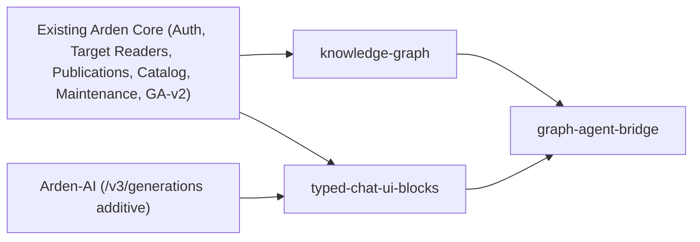

# Capability Map: Knowledge Graph and Modular Agent UI — V1

- Spec revision/date: `v1-accepted` (reconciled after single-model + cross-model adversarial reviews and approved) / 2026-11-26
- Decision state: **accepted** ([ADR 0036](../../decisions/0036-knowledge-graph-and-modular-typed-ui-blocks.md)); **implemented in local feature worktrees** (see [PLAN.md](PLAN.md) & [TASKS.md](TASKS.md))
- Originator: requesting project maintainer
- Decision owner: requesting project maintainer
- Record author: coding agent
- Approval: maintainer approved all architecture/scope decisions, reconciled `v1` specifications, and the 3 operational confirmations on 2026-11-26
- Intended audience: public-safe repository specification
- Source/code baseline and affected repositories: originally approved on `Arden` `origin/staging` `fa4d6fe` (`0001`–`0070`) and `Arden-AI` `origin/main` `af90033`; integrated on 2026-11-27 onto `Arden` `staging` `b4c6ef0` (migrations `0001`–`0074`, adding `0075`–`0077`) and `Arden-AI` `main` `5060291`
- Related Linear issues: `ARD-50` (Graph & context), `ARD-52` (Grounded agent), `ARD-59` (Conversation history)
- Supersedes / superseded by: supersedes `Sigma.js + Graphology` in [technology-guide.md](../../engineering/technology-guide.md#9-xyflowreact-d3-hierarchy-and-elkjs), [ARDEN_BLUEPRINT.md](../../../ARDEN_BLUEPRINT.md), and [implementation-status.md](../../engineering/implementation-status.md); resolves `G4` in [docs/product/README.md](../../product/README.md) (see [DECISION-CHANGE-SIGMA-TO-XYFLOW.md](DECISION-CHANGE-SIGMA-TO-XYFLOW.md))

---

## 1. Module Decomposition & Dependency DAG (Phase 0)

| Module ID | Deep-Module Responsibility | Depends On | Specification |
| --- | --- | --- | --- |
| `knowledge-graph` | Authorized Graph read projection (`F12`), replacement dual-endpoint `document_relationship` RLS + audited link API/UI, reviewed `SECURITY DEFINER` Governance Monitor projection, `@xyflow/react` + `d3-hierarchy` / lazy `elk.bundled.js` canvas, two-tier deep filters, Outline Treegrid view | Existing Auth, Target Readers, Publications, Maintenance, Catalog | [SPEC-knowledge-graph.md](SPEC-knowledge-graph.md) |
| `typed-chat-ui-blocks` | Self-contained Flat Adjacency `UiSurface` v1 contract & ancestor-invariant validator, additive `Arden-AI /v3/generations` (`answer-v3.schema.json`, opaque `sourceCatalog` handles, OpenAI `strict=True` array schema), Core authoritative DB hydrator & 4-path turn-level fail-closed revocation (`ai_conversation_turn.ui_surface` + `ai_turn_surface_binding`), recursive React block renderer in `AgentPanel` & `AskArdenPage` | Existing Governed Answering (`GA-v2`), `Arden-AI` | [SPEC-typed-chat-ui-blocks.md](SPEC-typed-chat-ui-blocks.md) |
| `graph-agent-bridge` | Explicit Graph Context Basket (`F12-AC3`, max 50 authorized docs) with SQL-pushed `scopeFilter` intersection + `scope_filter_hash` replay guard, unified shell-level `useArdenChat` + platform-agnostic `GraphIntentBus`, Desktop Electron concurrent IPC lane & allowlist, bidirectional `graph_action` & Flow 2/3/4 human-confirmed handoffs | `knowledge-graph`, `typed-chat-ui-blocks` | [SPEC-graph-agent-bridge.md](SPEC-graph-agent-bridge.md) |



**Build order:** `knowledge-graph` ∥ `typed-chat-ui-blocks` (truly independent parallel modules: `lineage_tree` in `typed-chat-ui-blocks` hydrates live through dual-endpoint RLS when `knowledge-graph`'s migration is present and degrades cleanly to empty otherwise) → `graph-agent-bridge`.

**Seam rule (`codebase-design`):** Each module exposes one narrow **Interface** at a clean **Seam** (`@arden/domain` contracts + Core service port + UI module props). `typed-chat-ui-blocks` owns the complete `UiSurface` / `SurfaceAction` type contract in `@arden/domain`; `graph-agent-bridge` consumes both upstream seams without creating cycles.

---

## 2. Master ISO/IEC 38505-1:2026 Governance Alignment Matrix

This specification operationalizes **ISO/IEC 38505-1:2026** (*Information technology — Governance of data — Part 1: Application of ISO/IEC 38500 to the governance of data*, second edition), aligned with **ISO/IEC 38500:2024** and **ISO 37000:2021**:
- **Clause 7:** The **11 governance principles** (1 central, 4 foundational, 6 enabling) applied to data.
- **Clause 8:** The updated four-activity governance model (**Engage stakeholders – Evaluate – Direct – Monitor**) mapped across the data lifecycle (Collection/Acquisition, Storage, Reporting, Decision/Use, Distribution/Sharing, Disposal/Archiving).

> **Honesty boundary:** [ARDEN_BLUEPRINT.md](../../../ARDEN_BLUEPRINT.md#L128) defines Arden's operational ISO/IEC 38505-1:2026 interpretation specifically for review policy and disjoint reviewer grants. This matrix extends Arden's engineering interpretation to the Knowledge Graph and Modular Agent UI; formal standard conformance and audit attestation remain the adopting organization's governance responsibility.

### 2.1 Clause 7 — Eleven Governance Principles Mapped to Modules

| Tier | Principle | Arden Operational Control | Owning Module(s) | Verifiable Invariant |
| --- | --- | --- | --- | --- |
| **Central** | **1. Purpose** | Keep Company knowledge discovery and AI assistance strictly grounded in authorized, current organizational guidance—excluding unreviewed Private Notes and direct shares (`ADR 0034`). | All three modules | Company Graph and Company Ask Arden never surface Private Notes or unreviewed direct shares. |
| **Foundational** | **2. Value generation** | Make knowledge relationships, side-by-side policy comparisons (`comparison_table`/`split`), and branch-scoped AI reasoning (`Context Basket`) directly actionable without manual hunting. | `knowledge-graph`, `typed-chat-ui-blocks`, `graph-agent-bridge` | Scoped queries narrow retrieval to relevant authorized branches; deterministic fallback guarantees usable structured answers even when LLM layout is omitted. |
| **Foundational** | **3. Strategy** | Pair the default **Accountability View** with the Admin-curated **Collections View** (`ADR 0026`) so strategic Org-wide guidance stays visibly distinct from `Shared (Department / Selected Members / Legacy Audience)` work. | `knowledge-graph` | Org Collections contain only eligible Org-wide publications; legacy untyped/unconfigured rows stay visible and labelled rather than dropped. |
| **Foundational** | **4. Oversight** | Opt-in **Governance Monitor Mode** backed by a reviewed `SECURITY DEFINER` projection surfaces expiry risk (`Expiring ≤ 30d`), authorized open maintenance cases (`0043`/`0060`), unassigned Org docs, and expired documents awaiting renewal/withdrawal. | `knowledge-graph`, `typed-chat-ui-blocks` | Ordinary readers never see Monitor signals or expired docs (`ADR 0032`); Org Admin opening restricted/expired bodies always routes through `ADR 0023` audited inspection. |
| **Foundational** | **5. Accountability** | Default **Accountability View** (`Org → Owner Dept → Controlled Type → Published Docs`) + Core-hydrated `governance_kv` (Owner Dept, active Author/`—`, Type, Version, Published Date, effective Valid Until via `publication_expiration_date()`, Reader Scope, Collection). | `knowledge-graph`, `typed-chat-ui-blocks` | Every published node traces to an accountable Owner Department; reviewer grants stay disjoint (`ADR 0013`/`0015`); reviewer and selected-reader identities never leak. |
| **Enabling** | **6. Stakeholder engagement** | Surface explicit Reader Scope badges, transparent Context Basket pills before sending, human-confirmed Flow 4 issue reporting (`workflow_handoff: report_issue`), Author/Reviewer renewal handoffs (`ADR 0032`), and per-turn 👍/👎 feedback (`0066`). | All three modules | Users see exact pinned documents before sending; `prompt_chip` prefills for human review (never auto-submits); `workflow_handoff` opens confirmation dialogs only. |
| **Enabling** | **7. Leadership** | Enforce explicit human governance authority: Authors/Org Admins declare governed `document_relationship` edges (audited per `ADR 0035`), while AI acts strictly as an advisor with zero autonomous write authority. | `knowledge-graph`, `typed-chat-ui-blocks` | All consequential link writes require active Author/Admin authority + dual-endpoint read access and emit `DOCUMENT_RELATIONSHIP_*` audit rows; AI actions are non-mutating. |
| **Enabling** | **8. Data and decisions** | Enforce verifiable evidence provenance: opaque `sourceCatalog` handles (`D1..D8`) in `/v3/generations`, verbatim citation checks (`CQ-1`–`CQ-4`), mandatory row citations on `comparison_table`, Core-only hydration of governance metadata and `metric_strip` counts, and live re-hydration on history reload. | `typed-chat-ui-blocks`, `graph-agent-bridge` | LLM cannot forge document IDs, governance metadata, warning callouts, or numeric metrics; saved turns re-hydrate fresh expiry/case status on every reload. |
| **Enabling** | **9. Risk governance** | Defense-in-depth PostgreSQL `FORCE RLS` (dropping `0027`'s permissive author policies), dual-endpoint edge filtering, uniform `404 RESOURCE_NOT_AVAILABLE` anti-oracle responses, SQL-pushed `scopeFilter` intersection, ancestor-invariant `UiSurface` bounds, and 4-path turn-level fail-closed revocation (`F14-AC2`). | All three modules | Zero hidden-node counts, zero dangling half-visible edges, zero UUID probing oracles, zero revoked surface leaks across `load`, `replay`, `context`, and `append`. |
| **Enabling** | **10. Social responsibility** | Respect privacy minimization, dignity, and accessibility: zero emails/selected-reader lists in Graph or AI surfaces, zero PII in audit payloads (`ADR 0035`), full WAI-ARIA `role="treegrid"` Outline parity (`< 768px` mobile default), and `prefers-reduced-motion` / `prefers-reduced-transparency` compliance. | All three modules | WCAG 2.2 AA Outline keyboard parity; zero PII/titles in `audit_event`; calm Island visual grammar without manipulative AI styling. |
| **Enabling** | **11. Viability and performance over time** | Bound Graph responses to 500 documents and 1,000 edges, the Context Basket to 50 documents, and surfaces to 48 KB compact and 64 KB `jsonb::text`. Use batched hydration and 2 MiB cursor pages, session-bound Desktop lanes and lazy Graph bundles. | All three modules | Verify Graph database timing separately from the response cap. History loads earlier whole turns without repeating shared summaries. Graph reads continue during AI generation in the same Desktop session. |

### 2.2 Clause 8 — Engage Stakeholders · Evaluate · Direct · Monitor × Data Lifecycle

| Lifecycle Stage | Engage Stakeholders | Evaluate | Direct | Monitor |
| --- | --- | --- | --- | --- |
| **Collection (Acquisition)** | Authors and Org Admins review explicit linked guidance and declare cross-document lineage (`REFERENCES` / `RELATED` / `SUPERSEDES`). | Inspect unlinked or newly published documents by Owner Dept & Type in Graph. | Enforce dual-endpoint read gate, `SUPERSEDES` acyclicity lock, and symmetric `RELATED` dedupe on `document_relationship` writes. | Persist `DOCUMENT_RELATIONSHIP_CREATED/DELETED` in `audit_event` (IDs + type only, `ADR 0035`); reject cross-org, self, and unreadable-target links with uniform `404`. |
| **Storage** | Keep conversation history strictly owner-private and transparent about unavailable turns. | Verify Org-wide documents are organized in Collections vs `Unassigned` without losing legacy rows. | Persist only validated unhydrated `BoundUiSurface` + `scope_filter_hash` + normalized `ai_turn_surface_binding` rows (never raw chunk copies). | `FORCE RLS` + ownership-handoff verification + PostgreSQL `ck_ai_turn_ui_surface_shape` (`<= 64 KB` `jsonb::text`) and FK integrity. |
| **Reporting** | Present clear, accessible modular blocks (`comparison_table`, `governance_kv`, `tabs`, `split`) with copyable complete plain-text `answer` and 👍/👎 feedback. | Evaluate policy differences and conflicts across cited documents side by side. | Core deterministically hydrates all governance fields, live `publication_expiration_date()`, `list_publication_author_names()`, and `metric_strip` counts; LLM `callout` restricted to cited `"info"|"conflict"`. | Privacy-safe fallback telemetry when `/v3/generations` omits or invalidates a surface; verbatim citation alignment (`CQ-1`–`CQ-4`). |
| **Decision (Use)** | Show exact pinned Context Basket documents above the composer before sending; `prompt_chip` prefills for user confirmation; `pin_to_context` shows visible confirmation + Undo. | Scope Ask Arden to exact branches/documents via SQL-pushed `scopeFilter` + scoped `sourceHints` and `context.history`. | Route all operational actions strictly through human-confirmed `workflow_handoff` dialogs (`ReportIssue`, `MaintenanceCase`, `Renewal`)—zero autonomous mutations. | Preserve Flow 4 Maintenance case history and Flow 2 review/renewal audit records for every human decision. |
| **Distribution (Sharing)** | Display honest Reader Scope labels (`Organization`, `Department`, `Selected Members`, `Legacy Audience`) without exposing restricted reader identities. | Filter Graph by `Reader Scope` to audit audience distribution across departments. | Enforce replacement dual-endpoint `document_relationship` RLS and exclude Private Notes / unreviewed direct shares (`ADR 0034`). | Real-PG negative RLS tests verify unselected readers and cross-org actors receive zero nodes, edges, collections, or hidden counts. |
| **Disposal (Expiry / Withdrawal)** | Route Authors, Responsible Reviewers, and Org Admins via explicit `openTarget` (`MY_CONTRIBUTIONS`, `RESPONSIBLE_VIEW`, `ADMIN_INSPECTION`) to renew or withdraw expired guidance. | Use role-gated **Governance Monitor Mode** (`Expiring ≤ 30d`, `Open Maintenance Cases`, `Expired`) to prioritize stale policies. | Hide expired/withdrawn documents immediately from ordinary readers' Graph, Collections, Context Basket, and AI eligibility (`ADR 0032`). | 4-path turn-level fail-closed revocation (`load`, `replay`, `context`, `append`) withholds stored turns + `UiSurface` the instant any bound source expires, withdraws, or loses access. |

---

## 3. Shared Security Threat Model (STRIDE + OWASP LLM Top 10 2025)

### Trust Boundaries
1. **Browser / Electron Renderer → Arden Core (`apps/api`):** Untrusted queries, filter params, `scopeFilter.documentIds`, and relationship mutations. In Electron, additionally gated by `apps/desktop/src/main/apiRequestPolicy.ts`.
2. **`Arden-AI` (`/v3/generations`) → Arden Core (`apps/api`):** **Untrusted LLM output** (`uiSurface` array nodes, text, citations, labels, handle refs). Core treats every model field as hostile input (OWASP **LLM05**).
3. **Published Document Text → LLM Prompt Context:** Document contents may carry indirect prompt injections attempting to spoof warning callouts, forge document IDs, auto-submit `prompt_chip`s, or steer `pin_to_context` (OWASP **LLM01 / LLM06 / LLM09**).
4. **Arden Core → PostgreSQL (`arden_runtime`):** Defense-in-depth `FORCE RLS` + reviewed `SECURITY DEFINER` routines listed in `deploy/release/security-definer-owner-repair.sql`.

### STRIDE & OWASP LLM Mitigation Summary

| Threat | Attack Scenario | Mandatory Control |
| --- | --- | --- |
| **S — Spoofing / Forgery (LLM05/LLM09)** | Prompt-injected doc tricks LLM into emitting `"Policy X revoked, call ext. 555"` as a `warning` callout or forging `"Valid until 2099"` / unknown UUIDs. | LLM receives only opaque `docRef` handles (`D1..D8`), never raw UUIDs; Core hydrates all document/governance/metric fields from PostgreSQL; LLM `callout` is restricted to cited `"info"|"conflict"` (`"warning"`/`"gap"` are Core-only); `comparison_table` requires row-level `citationIndexes`; `INSUFFICIENT_EVIDENCE` rejects LLM surfaces completely. |
| **T — Tampering / XSS (LLM01/LLM05/LLM06)** | LLM injects `<script>`, `javascript:` URLs, prototype keys (`__proto__`), 1-click auto-submit `prompt_chip`, or silent `pin_to_context`. | Zero URL fields in `UiSurface`; `prose` uses Arden's zero-dependency React element renderer (`layoutCitedAnswer`, zero `innerHTML`, zero raw HTML) — note Web nginx (`web.conf`) currently sets `nosniff` without a CSP header and Electron allows `style-src 'unsafe-inline'`, so React auto-escaping + zero raw HTML/URLs is the mandatory primary XSS defense; prototype keys rejected + `Object.hasOwn`/`Map`; `prompt_chip` prefills+focuses only; `pin_to_context` shows visible confirmation toast + 1-click Undo. |
| **R — Repudiation** | Author or Admin silently adds/removes `SUPERSEDES` links affecting organizational interpretation. | Consequential audit rows (`DOCUMENT_RELATIONSHIP_CREATED` / `DOCUMENT_RELATIONSHIP_DELETED`) recording actor, org, IDs, and type only (never titles/content) per `ADR 0035`; append-only `document_relationship_idempotency` ledger (`409 IDEMPOTENCY_CONFLICT`). |
| **I — Information Disclosure (A01, LLM02, LLM08)** | (a) Leftover `0027` permissive RLS leaks restricted targets; (b) `403` vs `404` probes target UUIDs; (c) Empty Org Collection leaks expired doc; (d) `openMaintenanceCaseCount` leaks reports to ordinary readers (`ADR 0023` §5) or Authors (`0043`/`0060`); (e) Out-of-scope docs leak via `sourceHints` or `context.history`; (f) Saved `uiSurface` leaks revoked content on reload/replay/context. | (a) `0076` explicitly drops all three `0027` policies; (b) Uniform `404 RESOURCE_NOT_AVAILABLE`; (c) Collections list omits empty collections with zero returned authorized docs; (d) `openMaintenanceCaseCount` is `null` (omitted) whenever caller lacks `0060`/Admin maintenance visibility; (e) `scopeFilter` pushed into SQL + scopes `sourceHints` and `context.history`; (f) 4-path turn-level fail-closed revocation (`load`, `replay`, `context`, `append`). |
| **D — Denial of Service (LLM10)** | Cyclic `UiSurface`, ancestor-bypassed `card→stack→card`, `depth > 4`, `nodes > 32`, `60 KB` compact JSON overflowing `64 KB` Postgres `jsonb::text`, unbounded `relationships[]` or 50 hydrated turns blowing Electron `1 MiB`, or 60s AI call freezing Electron `requestQueue`. | Hard bounds: `maxDepth = 4` (0-based), `maxNodes = 32`, ancestor-invariant bans, `48 KB` compact / `64 KB` `jsonb::text`, `500` docs + `1,000` edges, batched conversation-level `hydratedDocuments` + cursor paging (`2 MiB` Electron conversation limit), concurrent Desktop read/AI IPC lane, and `<= 250` nodes / `<= 500` edges threshold for main-thread `elk.bundled.js`. |
| **E — Elevation of Privilege (A01)** | Non-accountable reader sends `monitor=true&includeExpired=true`; Org Admin links or opens unreadable restricted docs without inspection; runtime spoofs `created_by_membership_id` or `arden.org_admin`. | Server derives Monitor capabilities from active DB membership/grants (`role_assignment`, `0060` disjoint reviewer grants); `INSERT` requires dual-endpoint read access and `created_by_membership_id = actor_membership`; Admin opening restricted/expired bodies always routes through `openTarget: "ADMIN_INSPECTION"` (`ADR 0023`). |

---

## 4. Shared Engineering Baseline (Commands, Boundaries, V2 Deferrals)

### Executable Verification Commands (from `Arden/` repository root)

```powershell
# Typecheck all workspaces
pnpm -r typecheck

# Unit & UI tests across domain, API, UI, and desktop IPC allowlist
pnpm -r test

# Build API, Web, and Electron Desktop bundles (and measure lazy /graph & elk.bundled.js chunk sizes)
pnpm -r build

# Verify migration ledger, SHA-256 checksums, and release-policy.json
pnpm migrations:check

# Start local PostgreSQL 17 for real FORCE RLS + ownership-handoff tests
pnpm db:up

# Remote workflow & release tooling checks
pnpm test:remote
```

*(In `Arden-AI/` repository root: `uv run pytest`, `uv run ruff check .`, `uv run mypy src`.)*

### Three-Tier Implementation Boundaries
- **Always do:** Enforce server-side authorization and `FORCE RLS` before projection; validate every external and LLM payload at the boundary; register new migrations in `apps/api/migrations/release-policy.json` and any new `SECURITY DEFINER` routine in `deploy/release/security-definer-owner-repair.sql`; add Electron IPC allowlist coverage in `apiRequestPolicy.ts` for every new/modified route; keep `Arden` strictly public-safe (zero private-repository filenames or local paths); preserve `Home` default (`ADR 0022`), `ADR 0026`, `ADR 0032`, `ADR 0023`, `ADR 0034`, and `ADR 0035`; run real-PG RLS + `/break-ui` + `/review-animations`.
- **Ask first:** Adding any new npm/Python dependency (`@xyflow/react`, `d3-hierarchy`, `elkjs` — requires lockfile + `pnpm audit` check); allocating new operator migration numbers past `0070`; adding any new `SECURITY DEFINER` routine to the 54-routine inventory; modifying `Arden-AI` provider prompts/models; committing, pushing, opening PRs, or deploying.
- **Never do:** Trust client-side hiding or LLM-emitted metadata/counts; mutate `/v2/generations` in place in a way that breaks un-upgraded callers; pass raw PostgreSQL UUIDs for LLM surface generation; expose hidden counts, restricted reader lists, or unauthorized maintenance counts; render raw HTML or arbitrary URLs in `UiSurface`; allow AI actions to execute write mutations directly; put Private Notes or direct shares into the Company Graph; weaken `FORCE RLS`, grant `BYPASSRLS`, or rewrite applied migrations (`0001`–`0070`).

### Explicitly Out of Scope (Deferred to V2)
1. **SSE progressive streaming of `UiSurface` JSON patches** (and Electron main-process streaming IPC rewrite).
2. **Automated multi-hop AI blast-radius simulation** (`impact_blast_radius` cross-document conflict analysis).
3. **Private Notes / direct-share personal graph** (`ADR 0029`/`0034`).
4. **External Jira / GitHub source nodes and actions (`F16` / `F17`)**.
5. **Custom free-form saved user node coordinates**.
6. **Nginx Web CSP header rollout (`web.conf`)** — tracked as separate infrastructure hardening (meanwhile React element auto-escaping + zero raw HTML/URLs remains mandatory).

---

## 5. Resolved Confirmations (Approved 2026-11-26)

1. **Sigma.js consultation timing (resolved):** Asynchronous team consultation occurs on the specification/implementation PR (public records do not name a separate individual author for Sigma.js).
2. **Desktop `/ai/answers` timeout (resolved):** Promote `POST /ai/answers` in `apps/desktop/src/main/apiRequestPolicy.ts` to a main-owned **`120_000 ms`** deadline (matching `Arden-AI`'s `120s` OpenAI timeout and replacing the current unbounded `undefined` timeout).
3. **Link editor & branch-chip UI (resolved):** Place `GraphRelationshipDialog` strictly on published documents (Document Detail / Reader Info Panel and Graph node floating toolbar, not the unpublished draft form), and render pinned branches as compact summary chips (e.g., `Engineering · 8 docs`) while still transmitting explicit `documentIds[]` on the wire.

**Open Questions:** None — Phase 1 specification is locked; see [PLAN.md](PLAN.md) and [TASKS.md](TASKS.md) for Phase 2/3 delivery breakdown.
