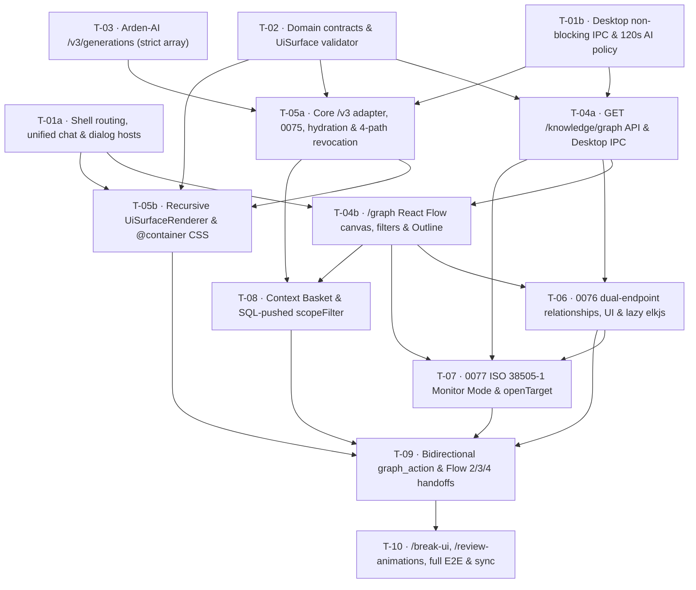

# Implementation Plan: Knowledge Graph and Modular Agent UI — V1

- Plan revision/date: `v1-plan-4` / 2026-11-27
- Status: **Approved on 2026-11-26. T-01a through T-10 are implemented and locally verified on the integrated `b4c6ef0` (`Arden`) and `5060291` (`Arden-AI`) branches; awaiting authorized commit, PR review, and paired staging rollout.**
- Source specifications (all `v1-accepted` on 2026-11-26):
  - [CAPABILITY-MAP.md](CAPABILITY-MAP.md)
  - [SPEC-knowledge-graph.md](SPEC-knowledge-graph.md)
  - [SPEC-typed-chat-ui-blocks.md](SPEC-typed-chat-ui-blocks.md)
  - [SPEC-graph-agent-bridge.md](SPEC-graph-agent-bridge.md)
  - [ADR 0036](../../decisions/0036-knowledge-graph-and-modular-typed-ui-blocks.md) & [DECISION-CHANGE-SIGMA-TO-XYFLOW.md](DECISION-CHANGE-SIGMA-TO-XYFLOW.md)
  - [Flow 3 Graph and Agent diagrams](../../product/flows/flow-3-graph-and-agent.md)
- Task breakdown and verification checklist for `ARD-50`, `ARD-52`, and `ARD-59`. [TASKS.md](TASKS.md)
- The original feature bases were Arden `fa4d6fe` and Arden-AI `af90033`. The 2026-11-27 integration uses Arden staging `b4c6ef0d` (migrations `0001`–`0074`) and Arden-AI main `5060291d`, with uncommitted feature changes on both bases.

---

## 1. Overview

This plan delivers Arden's **Knowledge Graph (`F12`)**, **Modular Composable Agent UI (`F13`/`F14`)**, and **Bidirectional Graph ↔ Agent Bridge (`F12-AC3`)** in 13 small/medium vertical slices across two repositories (`Arden` and `Arden-AI`). Every slice preserves PostgreSQL `FORCE RLS`, ISO/IEC 38505-1:2026 (Clauses 7–8) accountability and stakeholder-engagement principles, Web + Windows Electron 44 parity, and Apple/Emil interaction craft.

---

## 2. Locked Architecture Decisions Driving Sequencing

1. **Prefactor first ("make the change easy, then make the easy change"):** Shell routing query preservation, `GraphIntentBus`, unified Company `useArdenChat`, shell-level `ReportIssueDialog`, and Electron's non-blocking AI/read IPC lane land in Wave 0 (`T-01a`, `T-01b`) so no downstream feature ticket fights shell coupling or IPC head-of-line blocking.
2. **Additive `/v3/generations` in `Arden-AI`:** `/v2/retrievals` and `/v2/generations` stay 100% untouched. `T-03` ships `/v3/generations` (`sourceCatalog` opaque handles + OpenAI `strict=True` array nodes + non-502 invalid-surface stripping) independently in `Arden-AI` before Core calls it in `T-05a`.
3. **Deterministic sequential operator migrations:** Staging already used `0071`–`0074` for System Admin and draft lifecycle changes. The unpublished feature migrations now follow them:
   - `0075_ai_turn_ui_surface.sql` (`T-05a`) adds `ai_conversation_turn.{ui_surface, scope_filter_hash}` and `ai_turn_surface_binding` with `FORCE RLS`.
   - `0076_graph_document_relationships.sql` (`T-06`) replaces the `0027` policies with dual-endpoint authorization, supports source-authorized ghost-edge cleanup, and adds relationship invariants and an append-only idempotency ledger.
   - `0077_graph_monitor_projection.sql` (`T-07`) adds `list_graph_monitor_documents(...)`. The verified inventory includes 62 trusted `arden` routines and three isolated `arden_system` routines.
4. **Zero-dependency `prose` + pure CSS `@container`:** `UiSurfaceRenderer` reuses Arden's existing `layoutCitedAnswer` (`CitedAnswer.tsx`) and CSS `@container (max-width: 439px)` (zero external Markdown library, zero `ResizeObserver` thrashing).
5. **Lazy-loaded graph dependencies:** `@xyflow/react` + `d3-hierarchy` load lazily on `/graph`; `elkjs/lib/elk.bundled.js` loads dynamically on demand ONLY when cross-links are enabled (`<= 250` nodes / `<= 500` edges main-thread guard; zero `blob:` Web Workers under Electron CSP).

---

## 3. Ticket Dependency DAG & Parallelization Waves

### Delivery Waves & Verification Checkpoints

| Wave | Parallelizable Tickets | Checkpoint Gate |
| --- | --- | --- |
| **Wave 0 — Foundations & Prefactoring** | `T-01a` ∥ `T-01b` ∥ `T-02` ∥ `T-03` | **CP-1:** `pnpm -r typecheck`, `pnpm -r test`, `Arden-AI` `uv run pytest && ruff && mypy` green; shell routing & Desktop IPC non-blocking verified; `UiSurfaceValidator` adversarial fuzz suite green; OpenAI `strict=True` schema validated. |
| **Wave 1 — Core Module Tracer Bullets** | (`T-04a` → `T-04b`) ∥ (`T-05a` → `T-05b`) | **CP-2** Exercise Graph and modular chat on PostgreSQL, Web and Desktop. Reopen a long saved conversation in both chat views, load earlier turns, and verify each serialized page fits the 2 MiB Desktop limit. Check revocation during metadata hydration. |
| **Wave 2 — ISO/IEC 38505-1:2026 Governance Depth** | `T-06` → `T-07` | **CP-3:** Verify dual-endpoint `0076` RLS, ghost-edge cleanup, lazy `elk.bundled.js`, live `lineage_tree`, `0077` Monitor Mode, `openTarget`, and `0060` maintenance privacy. The PostgreSQL ownership check covers 62 application routines and three isolated System Admin routines. |
| **Wave 3 — Bidirectional Bridge** | `T-08` → `T-09` | **CP-4:** Context Basket SQL-pushed `scopeFilter` (tested on `>500`-doc synthetic org) + `scope_filter_hash` `409` guard + bidirectional `graph_action` + `pin_to_context` Undo + Flow 2/3/4 handoffs verified on Web & Electron. |
| **Wave 4 — Craft QA & Delivery Evidence** | `T-10` | **CP-5 (Release Readiness):** `/break-ui`, `/review-animations`, full post-ownership PG suite, Web + Windows Electron 44 builds & signed-in walkthrough, Flow 3 diagram status update, and paired team-knowledge sync ready for authorized publication. |

---

## 4. Local implementation and shared delivery gates

1. The integration worktrees reconcile the feature with Arden staging and Arden-AI main. T-10 records the 0075–0077 migration sequence, PostgreSQL ownership handoff, dependency audit, build measurements, and signed-in Web and Desktop evidence.
2. Check the module acceptance matrices before shared delivery. They identify the testing level and any gap for each acceptance ID.
3. Obtain separate authority for commits, pushes, PRs, shared database work, deployments and paired team-knowledge publication. Release additive `Arden-AI /v3/generations` before the matching Core rollout. Core supports the v2 path with `ARDEN_AI_UI_SURFACE_V3=false`. [Operations](../../engineering/operations.md)

---

## 5. Risks & Mitigations

| Risk | Impact | Mitigation |
| --- | --- | --- |
| Migration number collision with concurrent staging PRs (e.g. unmerged `feat/system-console-least-privilege`) | High | Re-fetch `origin/staging` immediately before creating each migration (`T-05a`, `T-06`, `T-07`); allocate next free sequential number and verify with `pnpm migrations:check`. |
| `elkjs` unpacked size (8.2 MB) bloating main bundle or freezing UI thread | High | Lazy-load `@xyflow/react` on `/graph`, dynamically import `elkjs/lib/elk.bundled.js` ONLY when cross-links toggle ON, enforce `<= 250` nodes / `<= 500` edges main-thread threshold, and measure exact Vite chunk sizes in `T-06`/`T-10`. |
| OpenAI `strict: true` rejecting complex `UiSurface` schemas or an invalid surface blocking text delivery | High | Check the compiled schema with the `T-03` strict-schema fixture, including its five-object nesting limit. Validate the answer and citations separately from the surface in the provider adapter. Confirm live provider acceptance during paired integration. |
| `0027` policy replacement breaking `target-readers.integration.test.ts:417–434` | Medium | Explicitly update that test fixture inside `T-06` to publish `source` and `target` before linking, while adding strict dual-endpoint/ghost-edge/oracle tests. |
| Desktop response size, blocked reads or stale authenticated requests | High | Keep independent read/AI lanes inside the active session, discard results when the session changes, and enforce byte limits while reading responses. Cap Graph edges at 1,000. Deduplicate `hydratedDocuments` and enforce 2 MiB per saved chat page. |
| Graph publication projection at scale | High | The 500-document cap bounds the response. Evaluate current pointers and versions before metadata joins and compute expiry once per version. Carry the 505-document PostgreSQL case and query timing into integration verification. |

---

## 6. Open Questions

The specification and 13-ticket breakdown were approved on 2026-11-26. See T-10 for the remaining acceptance and shared delivery gates. [TASKS.md](TASKS.md#t-10-evidence-on-the-integrated-build)
