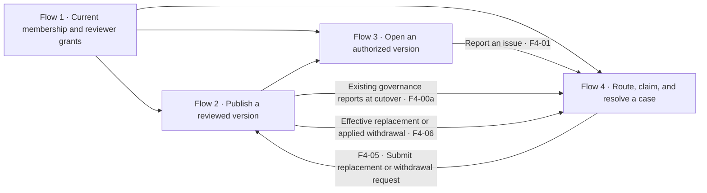

# Arden product flows

Baseline checked 2026-11-20. The local Flow 4 candidate on staging `4df192d` passed the disposable staging upgrade and one signed-in Web/Electron case walkthrough. The opt-in provider passed its separate synthetic live check. Shared release remains pending. The [Flow 4 step catalog](flow-4-sequences.md) records the current source and evidence.

| Flow | Role in the lifecycle | Owning material |
| --- | --- | --- |
| 1. Organization and access | Supplies membership, document access, reviewer grants and reassignment authority. | [Identity and access](../identity-and-access.md) |
| 2. Contribution and publication | Reviews, indexes, activates, replaces and withdraws official documents. | [Knowledge lifecycle](../knowledge-lifecycle.md), [review and publication contract](../../engineering/mainflow-2-workflow.md) |
| 3. Discovery and retrieval | Opens an authorized exact document version from Home, Knowledge Graph, search or a citation, and renders governed modular Ask Arden surfaces. | [Discovery and AI](../graph-ai-and-work.md), [Graph and Modular Agent diagrams and local evidence](flow-3-graph-and-agent.md), [Graph & Agent Capability Map](../../features/graph-and-agent-ui/CAPABILITY-MAP.md), [reader AI contract](https://github.com/Arden-Enterprise/Arden/blob/0eae5b8/docs/engineering/reader-ai.md) |
| 4. Knowledge maintenance | Tracks post-publication issues and human resolution. | [Specification](flow-4-maintenance.md), [sequenced diagrams](flow-4-sequences.md), [Implementation status](../../features/knowledge-maintenance/STATUS.md), [glossary](../../../GLOSSARY.md) |

Update affected step IDs, diagrams, and step catalog when a flow, service boundary, permission, state transition or handoff changes. Status and source revision belong with each flow. Keep historical descriptions readable and dated.
