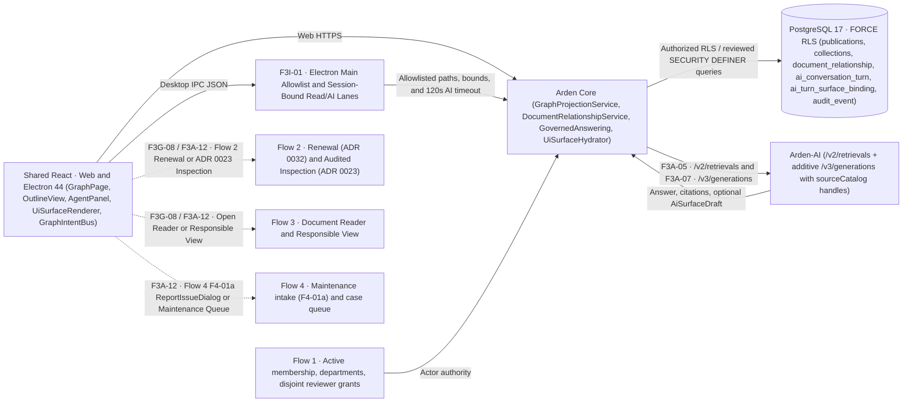
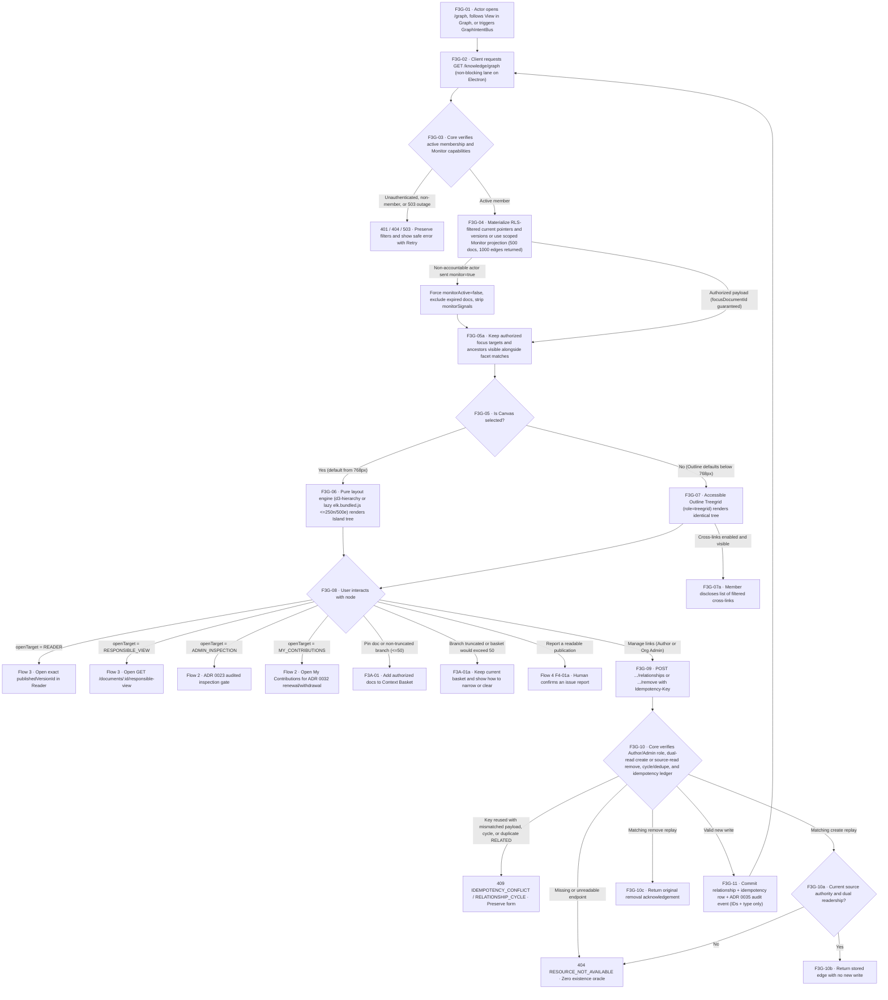
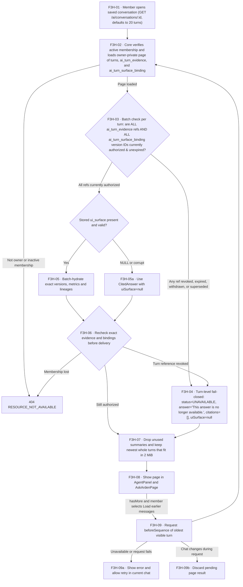
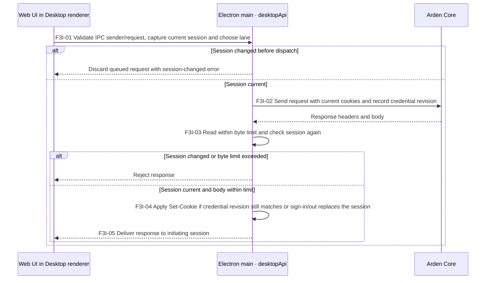

# Flow 3 · Knowledge Graph and Modular Agent UI diagrams

[Flow index](README.md) · [Capability Map](../../features/graph-and-agent-ui/CAPABILITY-MAP.md) · [ADR 0036](../../decisions/0036-knowledge-graph-and-modular-typed-ui-blocks.md) · [Glossary](../../../GLOSSARY.md)

The `v1-accepted` flow is implemented in local feature worktrees. The specifications record each path's observed checks and remaining acceptance work. [Graph](../../features/graph-and-agent-ui/SPEC-knowledge-graph.md#8-acceptance--evidence-matrix) · [Typed UI](../../features/graph-and-agent-ui/SPEC-typed-chat-ui-blocks.md#7-acceptance--evidence-matrix) · [Graph and Agent bridge](../../features/graph-and-agent-ui/SPEC-graph-agent-bridge.md#6-acceptance--evidence-matrix)

The 2026-11-27 integration worktrees build on `Arden` `staging` `b4c6ef0` (migrations `0001`–`0074`, adding `0075`–`0077`) and `Arden-AI` `main` `5060291` with uncommitted feature changes ready for authorized commit, review, and paired staging rollout.

---

## 1. System boundary overview



---

## 2. Knowledge Graph browsing, Monitor Mode, and governed cross-links (`F3G`)



*Audit visibility note (ADR 0035):* `F3G-11` creates and persists `DOCUMENT_RELATIONSHIP_CREATED` / `DOCUMENT_RELATIONSHIP_DELETED` in `audit_event` (IDs and link type only; never titles or content). An organization-wide audit log UI viewer is explicitly out of scope per [ADR 0035](../../decisions/0035-audit-only-consequential-actions.md).

---

## 3. Scoped Modular Agent Answering and Bidirectional Actions (`F3A`)

```mermaid
sequenceDiagram
    participant U as Member (Graph + Unified AgentPanel)
    participant UI as Shared React UI
    participant C as Arden Core (GovernedAnswering)
    participant DB as PostgreSQL 17 (FORCE RLS)
    participant AI as Arden-AI (/v2/retrievals + /v3/generations)

    U->>UI: F3A-01 Select docs/branch in Context Basket (<=50) and submit prompt
    opt Complete, unfiltered Graph refresh
        UI->>UI: F3A-01b Reconcile against reader-visible IDs and show a removal count when pins disappear
    end
    UI->>C: F3A-02 POST /ai/answers (query, conversationId, requestId, expectedRevision, optional scopeFilter)
    C->>DB: F3A-03 Check conversation revision and requestId + scope_filter_hash replay, then query listAuthorizedAiSources(scopeDocumentIds) for a new turn
    alt Revision conflict or requestId scope_filter_hash mismatch
        C-->>UI: 409 CONVERSATION_CONFLICT
    else Valid requestId replay
        C->>DB: F3A-03a Revalidate replay evidence and bindings, then hydrate live metadata
        C->>DB: F3A-10a Recheck evidence and bindings immediately before delivering the replay
        C-->>UI: Hydrated replay or 409 KNOWLEDGE_ACCESS_CHANGED
    else Authorized new turn
        alt Empty SQL intersection (0 authorized docs in scope)
            C->>C: F3A-04 Build INSUFFICIENT_EVIDENCE turn (evidence=[], Core gap callout)
        else Non-empty allowedGenerationIds
            C->>C: Scope sourceHints and context.history strictly to scopedBefore
            C->>AI: F3A-05 POST /v2/retrievals (allowedGenerationIds, scoped sourceHints, scoped history)
            AI-->>C: Ranked chunks with hashes (or timeout/503 -> safe error)
            C->>DB: F3A-06 Verify exact manifests, hashes, and live permissions
            C->>AI: F3A-07 POST /v3/generations (verified evidence, opaque sourceCatalog D1..D8, uiSurfaceMode: AUTO)
            AI-->>C: Validated answer and citations with a surface when the draft is valid
            C->>C: F3A-08 Validate citations + normalize/validate UiSurface (handles->UUIDs, acyclic, depth<=4, nodes<=32, <=48KB, ancestor bans, no LLM surface on INSUFFICIENT_EVIDENCE)
            alt Invalid or omitted AiSurfaceDraft
                C->>C: Log privacy-safe fallback reason and synthesize deterministic BoundUiSurface
            end
        end
        C->>DB: F3A-09 Lock conversation, recheck access and revision, then atomically insert the turn and bindings
        alt Pre-append access revoked
            C-->>UI: 409 KNOWLEDGE_ACCESS_CHANGED (prompt to ask again)
        else Committed
            C->>DB: F3A-10 Batch-hydrate live metadata (exact versions, case counts, lineages)
            C->>DB: F3A-10a Recheck exact evidence and surface bindings
            alt Access still current
                C-->>UI: Return answer, citations, BoundUiSurface, hydratedDocuments, turnHydration
                UI->>U: Render modular blocks (@container <440px split collapse; Stop waiting discards local wait only)
            else Access changed during hydration
                C-->>UI: 409 KNOWLEDGE_ACCESS_CHANGED (prompt to ask again)
            end
        end
    end
    opt User clicks allowlisted action
        U->>UI: F3A-11 Send Graph navigation to GraphIntentBus, pin with Undo, or prefill the composer
        U->>UI: F3A-12 open_reader -> Flow 3 Reader/Responsible View or Flow 2 Inspection; workflow_handoff -> Flow 4 F4-01a ReportIssueDialog / Maintenance or Flow 2 Renewal
        opt Responsible View or Renewal
            UI->>C: F3A-12a Recheck permission and exact publication on the existing responsible-view or renewals read
            C-->>UI: Authorized current data or unavailable state
        end
    end
```

---

## 4. Conversation Reload and Turn-Level Fail-Closed Revocation (`F3H`)



---

## 5. Desktop request delivery (`F3I`)



---

## 6. Linked Step Catalog (integrated snapshot on `b4c6ef0` / `5060291`)

| Step ID | Actor | Action | Screen / Component | API / Service | Data / Audit Event | Permission / Precondition | Output / State | Next Step |
| --- | --- | --- | --- | --- | --- | --- | --- | --- |
| `F3G-01` | Member | Open `/graph`, follow `"View in Graph"`, or receive `GraphIntentBus` intent | `AppSidebar`, `Home`, `Reader`, `ArdenShell` | Client Router / `GraphIntentBus` | Web URL query / Electron memory state | Authenticated org member | Graph workspace mounted | `F3G-02` |
| `F3G-02` | Client UI | Request authorized graph projection | `GraphPage` | `GET /knowledge/graph` | Read-only | Active session cookie | Skeleton state shown | Desktop `F3I-01`, otherwise `F3G-03` |
| `F3G-03` | Arden Core | Verify active membership and Monitor eligibility | — | `GraphProjectionService` | Checks membership, authored current+expired docs, `0060` disjoint grants, `role_assignment` | Active account, org, membership | Resolved actor capabilities | `F3G-04` or `401/404/503` |
| `F3G-04` | Arden Core | Load capabilities, materialized RLS readable publications (or guarded Monitor projection), and optional relationships inside one `withActor` transaction | — | PostgreSQL 17 (`PgGraphStore.loadGraphBundle`, `list_graph_monitor_documents`) | Live expiry per publication, uncapped `canRenew`, Org Collections and optional dual-endpoint edges | Reader visibility or scoped Monitor grant (`open_case_counts` skipped for non-accountable actors) | `KnowledgeGraphPayload` capped at 500 documents and 1,000 edges | `F3G-05a` |
| `F3G-05a` | Client UI | Reveal the requested document and its ancestors alongside facet matches | `GraphPage` | `GraphLayoutEngine` | Current `focusDocumentId`, facet matches and focus IDs | Focus document present in the authorized payload | Focus path is visible in Canvas and Outline | `F3G-05` |
| `F3G-05` | Client UI | Select Canvas or Outline presentation | `GraphPage` | Viewport check | Local view mode | `>= 768px` Canvas default; `< 768px` Outline default | Active renderer selected | `F3G-06` or `F3G-07` |
| `F3G-06` | Client UI | Compute pure layout and render interactive canvas | `GraphCanvas` (`@xyflow/react`) | `GraphLayoutEngine` (`d3-hierarchy` / lazy `elk.bundled.js`) | Derived client projection only | `elk.bundled.js` threshold `<= 250` nodes / `<= 500` edges | Interactive Island tree; client dim when non-truncated | `F3G-08` |
| `F3G-07` | Client UI | Render accessible Treegrid alternative | `GraphOutlineView` | `GraphLayoutEngine` | Derived client projection only | Identical filtered tree | `role="treegrid"` and cross-link disclosure | `F3G-07a` or `F3G-08` |
| `F3G-07a` | Member | Disclose cross-links | `GraphOutlineView` | `GraphLayoutEngine` | Same visible and filtered edges as Canvas | Cross-links enabled and both endpoints visible | Named, directional relationship rows | `F3G-08` |
| `F3G-08` | Member | Trigger node open, pin, or link management | `GraphCanvas` / `GraphOutlineView` | `openTarget` router | Context Basket / dialog state | `openTarget` (`READER`, `RESPONSIBLE_VIEW`, `ADMIN_INSPECTION`, `MY_CONTRIBUTIONS`), `canEditRelationships` | Opens Flow 3 Reader/Responsible View, Flow 2 Inspection/Renewal, `F3A-01`, or `F3G-09` | Flow 2 / Flow 3 / `F3A-01` / `F3G-09` |
| `F3G-09` | Author / Org Admin | Submit create or remove relationship | `GraphRelationshipDialog` | `POST .../relationships` or `.../remove` | Requires UUID `Idempotency-Key` | Active Author or Org Admin | Mutation sent to Core | `F3G-10` |
| `F3G-10` | Arden Core | Check relationship permissions, invariants and idempotency | — | `DocumentRelationshipService` | `document_relationship`, `document_relationship_idempotency` | Active membership, dual-read Author/Admin on create, Author (own current/expired source) or source-reading Admin on remove, and consistent request identity | Validated write, matching replay or `404`/`409` | `F3G-10a`, `F3G-10c` or `F3G-11` |
| `F3G-10a` | Arden Core | Check create replay authorization | — | `DocumentRelationshipService` | Current source authority and endpoint readership | Matching create key and payload | Allowed replay or uniform `404` | `F3G-10b` |
| `F3G-10b` | Arden Core | Return the stored edge | `GraphRelationshipDialog` | Create response | Stored result | Create replay authorized | Edge details with no additional audit or write | `F3G-02` |
| `F3G-10c` | Arden Core | Return the removal acknowledgement | `GraphRelationshipDialog` | Remove response | Stored acknowledgement | Matching remove key and payload, active membership | Acknowledged with no additional audit or write | `F3G-02` |
| `F3G-11` | Arden Core | Commit relationship + idempotency + consequential audit | — | PostgreSQL 17 | `audit_event` (`DOCUMENT_RELATIONSHIP_CREATED` / `DELETED`, IDs + type only) | Atomic transaction | Edge updated; Graph refreshes | `F3G-01` |
| `F3A-01` | Member | Select docs/non-truncated branch in Context Basket & submit prompt | `GraphPage`, unified `AgentPanel` / `AskArdenPage` | `GraphContextBasketStore`, hoisted `useArdenChat` | Session memory (hidden in Private; retry key includes `scopeFilterHash`) | Max `50` docs | Visible basket pills above composer | `F3A-02` |
| `F3A-01a` | Client UI | Refuse a truncated branch or a selection that would exceed the basket limit | `GraphPage`, status island | Context Basket | Existing pinned IDs | Truncated branch or more than 50 distinct IDs | Existing scope retained with a narrowing or limit message | `F3A-01` |
| `F3A-01b` | Client UI | Reconcile pins after a complete, unfiltered refresh | `GraphPage`, Company composer | `GET /knowledge/graph` | Reader-visible logical document IDs | Unfiltered, untruncated reader projection | Stale pins removed and only a count announced | `F3A-01` or `F3A-02` |
| `F3A-02` | Client UI | Send Ask Arden request | `useArdenChat` | `POST /ai/answers` (Desktop 120-second timeout) | `requestId`, `expectedRevision`, optional `scopeFilter` | Active Company chat | Pending indicator with local Stop waiting control | Desktop `F3I-01`, otherwise `F3A-03` |
| `F3A-03` | Arden Core | Validate the conversation revision and replay identity before selecting sources for a new turn | — | `GovernedAnswering` | `listAuthorizedAiSources(..., scopeDocumentIds)` before `LIMIT 501` | Active membership and unexpired current docs (`ADR 0030`/`0032`) | Authorized scoped sources, replay, or `409` | `F3A-03a`, `F3A-04` or `F3A-05` |
| `F3A-03a` | Arden Core | Authorize a saved reply and hydrate the exact versions it used | — | `GovernedAnswering` and `UiSurfaceHydrator` | Replay evidence and bindings | Same request, scope and current access | Hydrated reply candidate or `409` | `F3A-10a` |
| `F3A-04` | Arden Core | Build an insufficiency turn for an empty scope | — | `GovernedAnswering` | `evidence=[]`, Core gap callout | Zero authorized docs matched `scopeFilter` | Safe `INSUFFICIENT_EVIDENCE` turn candidate | `F3A-09` |
| `F3A-05` | Arden Core → AI | Run hybrid retrieval on `scopedBefore` | — | `Arden-AI POST /v2/retrievals` | Scoped `allowedGenerationIds`, `sourceHints`, and `context.history` | Core allow-list strictly enforced | Candidate evidence chunks (or `503` safe error) | `F3A-06` |
| `F3A-06` | Arden Core | Verify chunk manifests, hashes, and current permissions | — | `GovernedAnswering` | `knowledge_index_generation` manifest check | Pre-generation access still valid | Verified `Evidence[]` + opaque `sourceCatalog` (`D1..D8`) | `F3A-07` or `409` |
| `F3A-07` | Arden Core → AI | Generate and independently validate the answer and optional surface | — | `Arden-AI POST /v3/generations` | Strict array schema and opaque handles | `PUBLISHED_CHAT` | Valid answer and citations with a surface or a closed omission reason | `F3A-08` |
| `F3A-08` | Arden Core | Validate citations + normalize/validate `UiSurface` or build fallback | — | `UiSurfaceValidator`, `UiSurfaceHydrator` | Handles→UUIDs, acyclic, `depth<=4`, `nodes<=32`, `<=48KB`, ancestor bans, row citations, Core-only `warning`/`gap` | Untrusted LLM output (OWASP LLM01/05/09) | Validated unhydrated `BoundUiSurface` | `F3A-09` |
| `F3A-09` | Arden Core | Final recheck & atomic turn persistence | — | `PgConversationStore` | `INSERT ai_conversation_turn(ui_surface, scope_filter_hash)`, `ai_turn_evidence`, `ai_turn_surface_binding` | All evidence & bindings pass `eligible_ai_publications()` RLS | Committed turn or `409 KNOWLEDGE_ACCESS_CHANGED` | `F3A-10` |
| `F3A-10` | Arden Core | Batch-hydrate live DB metadata | — | `UiSurfaceHydrator` | `publication_expiration_date()`, `list_publication_author_names()`, `0060` maintenance count, live `lineage_tree` | Current actor permissions and capabilities | Hydrated turn candidate | `F3A-10a` |
| `F3A-10a` | Arden Core | Check exact evidence and bindings before returning answer or replay | `ChatMessages` | `GovernedAnswering` | New or saved turn | Hydration complete and all references still available | Authorized turn for UI or access-changed error | `F3A-11` / `F3A-12` |
| `F3A-11` | Member | Click `graph_action` or `prompt_chip` | `UiSurfaceRenderer` | `SurfaceActionDispatcher`, `GraphIntentBus` | Local state / Web URL sync | `pin_to_context` shows toast + Undo; `prompt_chip` prefills+focuses only | Interruptible Graph focus/filter/pin or prefilled composer | `F3G-06` / `F3A-01` |
| `F3A-12` | Member | Click `open_reader` or `workflow_handoff` | `UiSurfaceRenderer`, shell dialog hosts | `SurfaceActionDispatcher` | Zero autonomous server writes | Hydrated `openTarget` & capability booleans (`canReportIssue`, `canOpenMaintenance`, `canRenew`) | Cross-flow handoff to Flow 3 Reader/Responsible View, Flow 2 Inspection/Renewal, or Flow 4 `F4-01a` | Flow 2 / Flow 3 / Flow 4 `F4-01a` |
| `F3A-12a` | Client UI and Arden Core | Recheck the exact publication and live permission for responsible view or renewal | `GovernanceActionDialog` | Responsible-view or renewals read | Logical document ID and published version ID | Exact publication match and current permission | Read-only body, human-confirmed renewal form, or unavailable dialog | Flow 3 responsible view or ADR 0032 renewal |
| `F3H-01` | Member | Open a saved conversation | `AskArdenPage` | `GET /ai/conversations/:id` | Latest page, up to 20 turns by default | Owner-private RLS | History fetch initiated | `F3H-02` |
| `F3H-02` | Arden Core | Load owner-private turns, evidence, and surface bindings | — | `PgConversationStore` | `ai_conversation`, `ai_conversation_turn`, `ai_turn_evidence`, `ai_turn_surface_binding` | Active org membership + owner | Raw page of turns | `F3H-03` or `404` |
| `F3H-03` | Arden Core | Batch-revalidate ALL `ai_turn_evidence` AND `ai_turn_surface_binding` refs | — | `GovernedAnswering.load()` | `publishedVersionIds`-keyed `eligible_ai_publications()` + `canRead` | Every referenced source must remain current & authorized | Authorized vs Revoked verdict per turn | `F3H-04` or `F3H-05` |
| `F3H-04` | Arden Core | Withhold entire turn | `ChatMessages` | `GovernedAnswering.load()` | Redacted answer, no source metadata | Any reference revoked, expired, withdrawn or superseded | `UNAVAILABLE` turn | `F3H-07` |
| `F3H-05` | Arden Core | Batch-hydrate live metadata across surviving turns | — | `UiSurfaceHydrator` | Exact-version summaries, metrics and lineages | Valid stored surface and initially authorized references | Hydrated page candidates | `F3H-06` |
| `F3H-05a` | Arden Core | Preserve a cited answer when the stored surface is missing or invalid | `CitedAnswer` | `GovernedAnswering.load()` | `uiSurface: null` | Evidence initially authorized | Legacy answer candidate | `F3H-06` |
| `F3H-06` | Arden Core | Recheck evidence and bindings after hydration | — | `GovernedAnswering.load()` | Current permission to exact versions and chunks | Initial checks passed before hydration | Authorized, turn unavailable or `404` | `F3H-04` or `F3H-07` |
| `F3H-07` | Arden Core | Fit whole turns and only their deduplicated summaries into the byte limit | — | `GET /ai/conversations/:id` | UTF-8 JSON, `hasMore` and turn sequences | 2 MiB page ceiling | Authorized bounded page | `F3H-08` |
| `F3H-08` | Client UI | Show the saved page with fresh metadata and redactions | `ChatMessages` | `useArdenChat` | Ordered turns, summaries and cursor | Request belongs to the current chat | Transcript in AgentPanel and AskArdenPage | `F3H-09`, `F3A-11` or `F3A-12` |
| `F3H-09` | Member | Load earlier messages | `ChatMessages` | `GET /ai/conversations/:id?beforeSequence=…` | Oldest displayed sequence | Server reports `hasMore` | Prepended page with older turns, or retry control on failure | `F3H-02`, `F3H-09a` or `F3H-09b` |
| `F3H-09a` | Client UI | Show an earlier-page error in the open chat | `ChatMessages` | `useArdenChat` | Current cursor retained | Failed request for the current chat | Inline error and retry affordance | `F3H-09` |
| `F3H-09b` | Client UI | Discard an older request after switching chats or reloading | — | `useArdenChat` | Request identity and active conversation | Source conversation replaced | Current transcript stays selected | `F3H-08` |
| `F3I-01` | Electron main | Validate sender, request and lane at enqueue | Desktop preload and main | `arden:api-request` | Session epoch, request method and path | Trusted renderer and allowlisted request | Session-bound request | `F3I-02` or reject stale work |
| `F3I-02` | Electron main | Dispatch request with current session cookies and epoch-tracked `AbortController` | — | `desktopApi` | Current credential revision & active controller map | Same session since enqueue; any session change aborts prior-epoch fetches immediately to release `aiLock` | Core HTTP request | Core `F3G-03`, `F3A-03` or `F3H-02`, then `F3I-03` |
| `F3I-03` | Electron main | Read response within route budget and validate session | — | `desktopApi` | Streamed HTTP response bytes | Same session and body within limit | Response candidate or error | `F3I-04` |
| `F3I-04` | Electron main | Apply current credential changes under the jar lock | — | `desktopApi`, secure storage | Cookies and credential revision | Same session with current revision or explicit account transition | Current credentials retained or securely replaced | `F3I-05` |
| `F3I-05` | Electron main | Deliver the response for the current session | Web UI in Desktop renderer | `arden:api-request` | Status and bounded body | Session still current | Renderer updates its initiating view | `F3G-05a`, `F3A-11` / `F3A-12` or `F3H-08` according to route |
