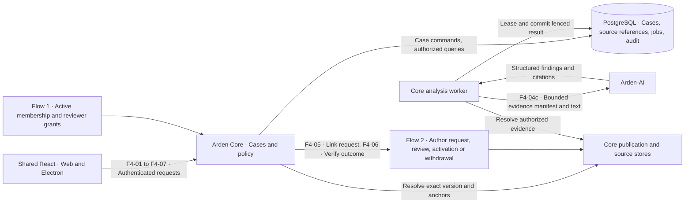
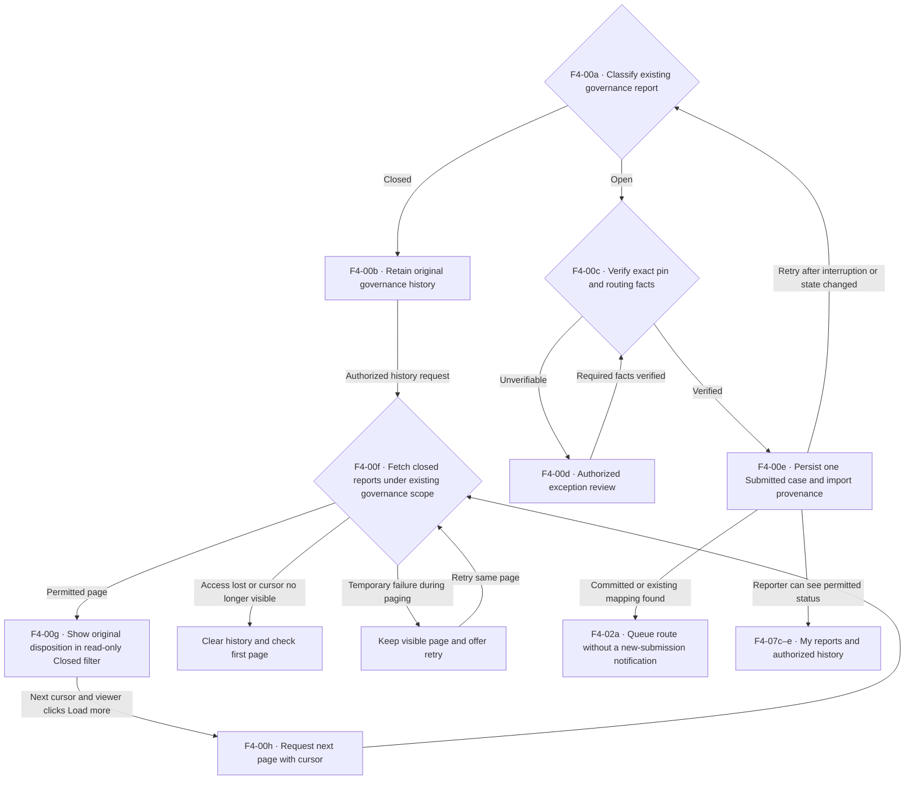
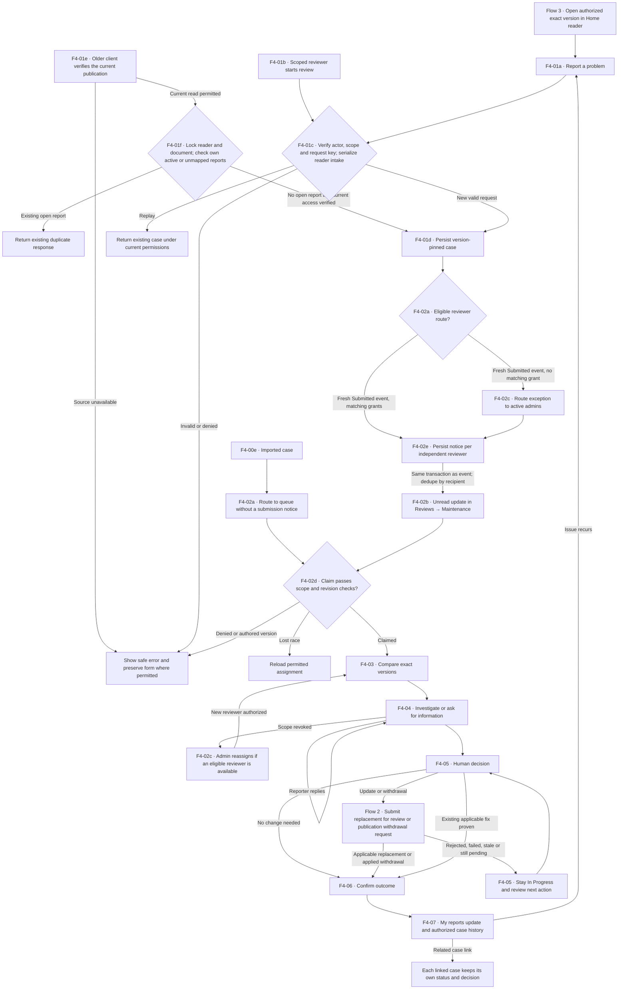
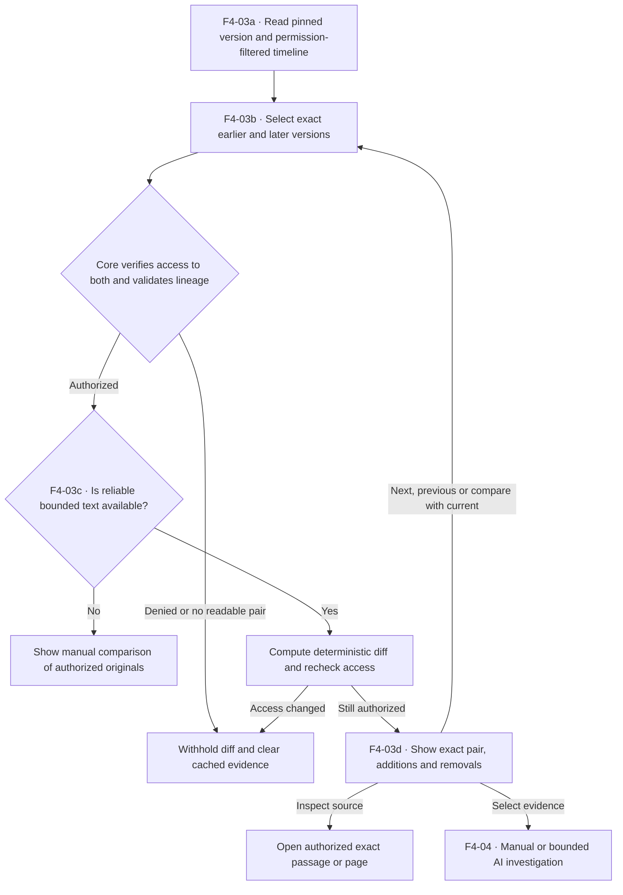
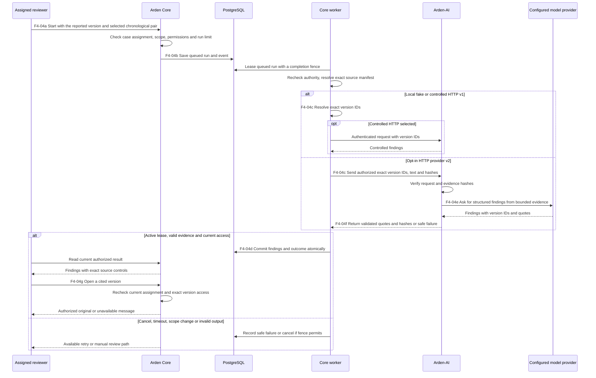
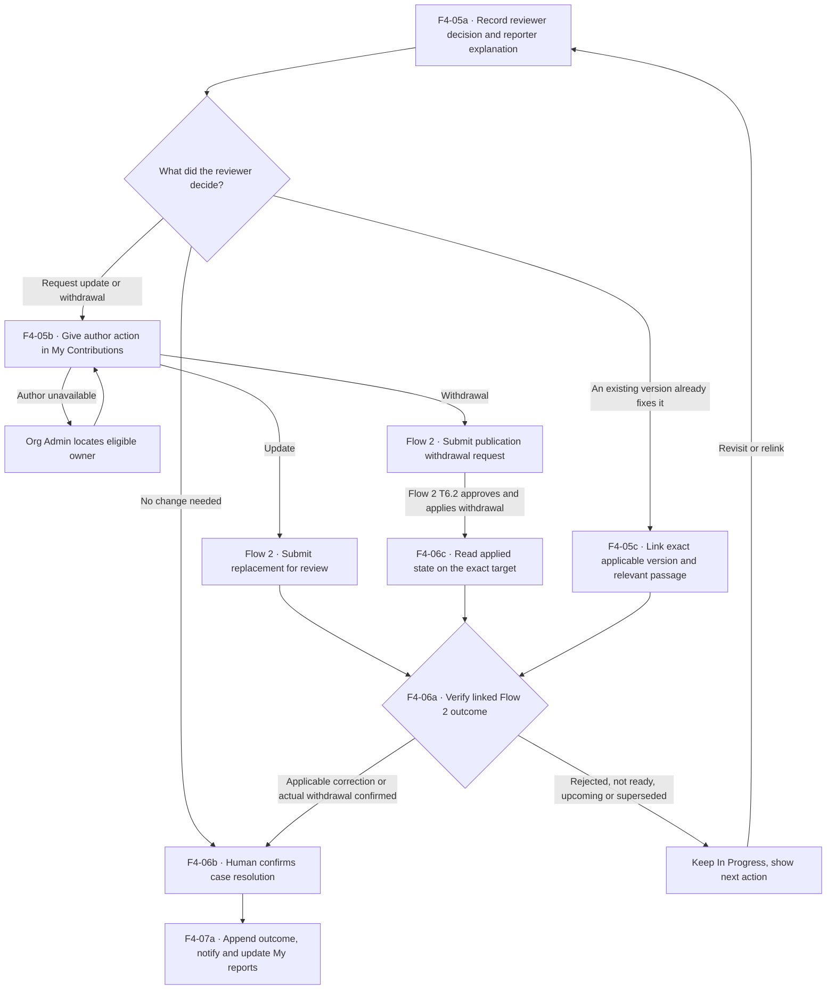
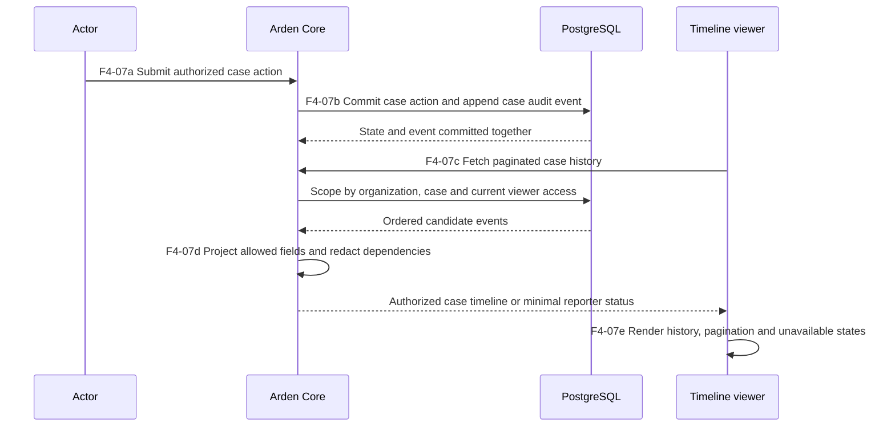

# Flow 4 · Sequenced diagrams

[Flow index](README.md) · [Specification and acceptance](flow-4-maintenance.md)

**Status** — Approved design. At local `d81b062` plus uncommitted runtime edits, the app connects the manual intake, claim, reassignment, no-change decision, history, stored version pairs, and one exact current-publication confirmation. The author Flow 2 handoff and the real AI path remain pending. A publication link is now required before the applicable confirmation. [Runtime plan](../../superpowers/plans/2026-11-19-flow-4-runtime-integration.md)

## System boundaries

**Local verification, 2026-11-20** — Arden at `d81b062` plus local changes verified Closed paging, new-report notices and case closure against PostgreSQL 17. The paired Arden-AI contract at `ed2776e` plus local changes tested the v2 contract and completed one authorized live call with exact synthetic citations. The combined staging checkpoint and its additional verification are recorded at the end of this catalog. [Evidence](../../features/knowledge-maintenance/STATUS.md)

**Integration checkpoint, 2026-11-18** — The local manual path is present at `c35737d`. Staging `af28915` uses 0036–0038 and has the existing problem-report path. The approved cutover in F4-00 carries open work forward and keeps one reader action for new cases. The [complete working plan](../../superpowers/plans/2026-11-18-flow-4-complete-working-plan.md) tracks implementation, database routing checks and server projection.

**Runtime checkpoint, 2026-11-19** — The sequence below is unchanged. On disposable PostgreSQL, a reader pins the current published version without reading the author-only draft. An administrator reassignment sets the existing admin flag inside the maintenance transaction. Removing the current publication pointer, not a validity date, is what hides the reporter's detail and history. Signed-in screens remain unverified.

## Existing reports at cutover

## Case intake and review

## Case-scoped comparison

## Analysis sequence

## Flow 2 handoff and confirmation

## Audit storage and display sequence

## Step catalog

| Step | Actor / surface | Core operation and prerequisite | State, data or audit output | Next | Evidence |
| --- | --- | --- | --- | --- | --- |
| F4-00a–b | Authorized cutover process / existing governance history | Classify current report disposition within the organization. Apply existing history permissions. | Open candidate or retained closed record and audit trail | F4-00c for open; history for closed | Implemented in the service. Closed rows stay in governance history. PostgreSQL classification remains unverified. |
| F4-00c–d | Cutover process and authorized exception reviewer | Verify original version, reporter attribution and governing routing facts. Recheck eligibility after reviewing an exception. | Eligible candidate or retained source awaiting review | F4-00e or hold at F4-00d | Implemented in the service. Unverifiable rows are held and are not imported. |
| F4-00e | Cutover process / Maintenance and My reports | Recheck current disposition and atomically persist or reuse one mapping, case and import event. Preserve source lineage and suppress fresh-submission notifications. | Unassigned Submitted case with original report facts and import provenance | F4-02a and F4-07c–e on success; F4-00a on retry | On `arden_test_flow4`, one admin import created unassigned Submitted case `2aad6d1d-69da-4375-a903-76c40b1d23d1`. A repeat added no case. Two overlapping imports of report `e5e5e5e5-e5e5-45e5-85e5-e5e5e5e5e5e5` both returned 200 and stored one Submitted case, `bb6f7a44-56ae-4dd0-bde9-28b9b1137845`, with one `IMPORTED` event. The losing request retried after the unique import row was already stored and added nothing. The reviewer queue and the reporter's My reports both showed it. Dismissing the source left that one case and `CLOSED:DISMISSED`. |
| F4-00f–g | Authorized governance viewer / Reported problems → Closed | Fetch permitted closed legacy reports under existing scope, then render the read-only authorized projection | Original disposition and permitted audit context or unavailable state | End or return to Reported problems | Signed-in admin on the disposable app saw “Closed history row” marked Dismissed, with no Dismiss, Inspect, or Withdraw on that row. The reporter's closed-report request returned no rows. That checkpoint capped the read at 200 rows. The 20 November update below adds cursor paging. |
| F4-01a–d | Reader or scoped reviewer, reader dialog / Maintenance | Create; authorize exact publication, anchor and origin; dedupe same request | Case ID, immutable version/hash, submitted event | F4-02a | Disposable PostgreSQL proved a non-author reader report and same-key replay. The anchor is read from the published version. The isolated signed-in reader submitted IT Support Guide v3 with a page and passage. On Scanned Spare Note, the same idempotency key returned case `ba53db24-fa31-4d31-8c6d-1ed2deecd5d2`, and a different description under that key returned 409. The stored description stayed the first one. A report pinned to superseded guide version 3 returned 404 and stored no case. A report sent to the other organization returned 404 and stored no case. Synthetic Reviewer started case `8b54bea3-b22d-40d4-8773-d9842515173c` as `REVIEWER_INTAKE` with no reporter membership. |
| F4-01e | Older client / existing reader report action | Preserve one open report per member and document. Recheck current exact source and compatibility policy. | Existing duplicate response or new case after closure | F4-01d for eligible new intake | Q24 verified locally with a signed-in race and identical wording after closure on the staging-upgraded database. |
| F4-02a–c | Core / Org Admin, queue or exceptions | Resolve responsible scope and eligible reviewers; reassign only to eligible independent person | Routed or Needs reassignment; assignment events and notifications | F4-02d | Disposable PostgreSQL proved admin reassignment to another eligible reviewer and denial of the former assignee. The signed-in admin chose **Synthetic Next** from a name list. The author was not listed. Deactivating the assignee's grant on case `2787171f-9777-42c2-be47-40d538821eee` left the case assigned, stopped compare and the version list, and restoring the grant returned the decision. Electron then showed “Needs reassignment. You can no longer decide this case.” The grant was restored afterward. Case `6a92f5b0-d1ad-4f5d-9ea5-1fda0a34eec9` was then stored as CONFIDENTIAL, which matches no active grant. The reviewer claim and an admin reassignment both returned 404. The admin eligible-reviewer list was empty. Electron showed “No eligible reviewer is available.” The case stayed Submitted, revision 1, with no assignee and no claim event. |
| F4-02d | Scoped reviewer, queue | Claim current revision atomically; enforce author exclusion and grant | One assignee, first claim timestamp, reporter In Progress | F4-05 no-change, or F4-03a when comparison ships | Disposable PostgreSQL proved one winning claim. The author and another organization were denied. The signed-in reviewer claimed the reported case and the status became In Progress. On case `0194e88f-bcfb-4cba-b005-814bdbbad5e8`, the author claim returned 404, Synthetic Reviewer won the simultaneous claim, and Synthetic Rival received 409. The stored row is In Progress at revision 2 with one `CLAIMED` event. The rival's following read was a queue view of that In Progress case. The wired no-change path does not require comparison. |
| F4-03a–d | Assignee, Version changes | List allowed history; verify exact pair and lineage; diff or manual original display | Authorized exact pair and source anchors | F4-04a or F4-05 | On `arden_test_flow4`, case `2aad6d1d-69da-4375-a903-76c40b1d23d1` listed versions 3, 4, and 5. The signed-in screen started at versions 3 to 4 and showed the added service-desk line. Next versions showed versions 4 to 5 and the added ticket line. Compare with current returned to versions 4 to 5. A missing version stayed unavailable, and the reporter was denied. An exact original opened from the added ticket line on case `2787171f-9777-42c2-be47-40d538821eee`. At 390px the change list stayed within the screen. Comparing version 5 with itself returned only unchanged lines. On Unchanged Lines Note, versions 1 to 2 collapsed the service-desk line, and **Show unchanged lines** revealed it in the web app and in Electron. Synthetic Admin later focused that button in Electron and pressed Space. It became **Hide unchanged lines** and the service-desk line appeared. Empty and unreadable text stay in the service test. Electron opened Scanned Spare Note, versions 1 to 2, and showed that comparison is unavailable. |
| F4-04a–d | Assignee and Core worker, Case / Findings | Ask for info or start a bounded run; recheck selected evidence and assignment before work and return | Reply plus evidence, or run terminal state with citations and audit | F4-05 | On case `2787171f-9777-42c2-be47-40d538821eee`, the signed-in reviewer queued a controlled run. Cancelling it left the findings empty. The retry succeeded on attempt 3 and **Open citation** landed on version 5, `78787878-7878-4787-8787-787878787878`. The adapter stayed inside Core. The Arden-AI HTTP hop and the live provider were not called. Electron later opened case `2cc54e13-eb11-424c-930f-fa6b94cc0e1d`, clicked **Retry analysis**, and clicked **Cancel analysis** while that run was still queued. Attempt 6 is `cancelled` with an empty fence and empty findings. The next retry stored attempt 7 as `succeeded` and left attempt 6 cancelled. The desktop request queue lets that cancellation POST leave while the analysis read is still waiting. On the same case, attempt 8 was queued by Synthetic Reviewer and the case was reassigned before that run finished. The original reviewer’s read returned 404. Synthetic Next’s read stored attempt 8 as `failed` with no findings. Attempts 6 and 7 stayed `cancelled` and `succeeded`. The case was then assigned back to Synthetic Reviewer and stayed In Progress. Attempt 9 was claimed and its lease was then set in the past. The commit stored that attempt as `failed` with no findings. Attempt 7 stayed `succeeded`. |
| F4-05a–c | Reviewer and author, decision panel and My Contributions | Record reason and selected remedy; author uses the matching Flow 2 submission/request; link same-document evidence | Decision/request event; case stays open for change | F4-06a or back to F4-04 | On `arden_test_flow4`, Synthetic Reviewer linked case `40c637b0-5efd-4f48-b766-24a9f5339c84` to resolved case `2aad6d1d-69da-4375-a903-76c40b1d23d1` and opened that sibling. Closing the new case as **No change needed** left the earlier **UPDATED** explanation in place. The reporter's link read was denied. A missing case id and reviewer-authored case `19191919-1919-4919-8919-191919191919` were both refused from case `2787171f-9777-42c2-be47-40d538821eee` and were not stored. Electron clicked **Link case** for the hidden id and showed “That case is unavailable.” Retry returned the same In Progress case with no related row. |
| F4-06a–b | Assigned reviewer, confirm action | Verify currently applicable replacement or actually applied withdrawal, or record reason for no change | Resolved outcome, public explanation and exact evidence ref | F4-07a | Disposable PostgreSQL proved **No change needed** after reassignment. On case `2aad6d1d-69da-4375-a903-76c40b1d23d1`, the current pointer was version 5. Confirming version 3 returned a conflict and left the case In Progress. The signed-in reviewer then confirmed version 5, the screen showed the public explanation, and the case became Resolved with outcome **UPDATED**. The reporter read returned only the case id and Resolved status because the case stays pinned to version 3. On case `51515151-5151-4515-8515-515151515151`, pinned to version 3, linking version 3 conflicted and linking version 5 left the case In Progress. Confirming version 3 then conflicted, and confirming the linked version resolved the case as **UPDATED**. The reporter read stayed minimal. Electron clicked **Link current publication** and **Record published outcome** on case `e0e0e0e0-e0e0-40e0-80e0-e0e0e0e0e0e0`, which was pinned to version 3. The stored outcome is **UPDATED** linked to version 5, and the reporter's web read stayed minimal. The same buttons were clicked on Unchanged Lines Note case `d0d0d0d0-d0d0-40d0-80d0-d0d0d0d0d0d0`. On Journey Close Note, case `abffcf22-0f8b-453b-8293-02bab340e4cf` was reported from the web. Electron claimed, compared, analyzed, and asked a question. The web reporter replied. The author requested withdrawal, the reviewer linked that pending request, and the case stayed open. The admin approved the withdrawal. Electron then recorded **WITHDRAWN**. The reporter's later read was minimal on the web and in Electron. IT Support Guide stayed on version 5. A pending withdrawal request stayed at publication state `NONE` and left case `52525252-5252-4525-8525-525252525252` In Progress. A signed-in admin withdrew Spare Withdrawal Note, and case `66666666-6666-4666-8666-666666666666` resolved **WITHDRAWN**. Synthetic Author requested a withdrawal, the organization admin approved it, and case `75757575-7575-4757-8757-757575757575` resolved **WITHDRAWN** while the request stayed at publication state `NONE`. |
| F4-07a–e | Core and authorized viewer, Audit history / My reports | Create, persist, query, project and render ordered case events | Role-safe timeline, minimal status or denied response | Related case F4-01a or end | Disposable PostgreSQL showed the public explanation to the reporter and hid the reviewer rationale. After the current publication pointer was removed, the reporter received only the case id and status and an empty history page. The signed-in reporter saw the public explanation and public history, and did not see the reassignment reason or reviewer rationale. A newer case load replaces an older one, and a minimal read clears history. A message that names the wrong revision is rejected and writes no event. On case `2787171f-9777-42c2-be47-40d538821eee`, the signed-in reviewer loaded a second history page through **Load more history**. On case `2cc54e13-eb11-424c-930f-fa6b94cc0e1d`, claim and question notices reached the reporter. My reports showed **Unread** before the case was opened and cleared it afterward. The new report itself stored no reviewer notice. |

### 2026-11-20 local verification and new steps

| Step | Actor and screen | API, data and permission | Result and next step | Evidence |
| --- | --- | --- | --- | --- |
| F4-00f–h | Authorized governance viewer, **Reported problems → Closed** | The governance report read rechecks organization and scope for every page, including cursor visibility. PostgreSQL orders by closure time, creation time and report ID. | Up to 200 retained read-only records and an optional cursor. A transient paging failure can retry. Loss of access clears the displayed page. | **Verified locally** with 205 timestamp-tied rows, two pages and reporter/foreign-tenant denial. |
| F4-02e → F4-02b | PostgreSQL after a fresh case event, then eligible user in **Reviews → Maintenance** | The submission trigger checks the actor, tenant, current version and routing facts. It persists recipient notices atomically with `SUBMITTED`, falls back to active admins if no reviewer matches and deduplicates replays. An `IMPORTED` event skips this step. | Persisted unread notice for authorized queue projection. Reviewer moves to F4-02d to claim. | **Verified locally** under the restricted runtime role. A real report pinned to version 3 produced 3 notices and its reviewer saw the unread entry. |
| F4-04c → F4-04e → F4-04f | Assigned reviewer, Core worker, Arden-AI and configured provider | Core authorizes and hashes the chosen evidence. Authenticated v2 transport accepts up to four bounded sources. Arden-AI and Core validate returned IDs and quotes. The worker rechecks authority and lease before commit. | Valid findings proceed to F4-04d. Unavailable provider, invalid output or lost authority returns a safe issue or retry according to current run state. | **Verified locally** with Node and Python contract checks and one live provider request through Arden-AI v2. Two synthetic citations matched exact source text and hashes. The reconciled signed-in web/Electron run remains open. |
| F4-06c → F4-06a | Assigned reviewer following [Flow 2 T6.2 approval](../../engineering/mainflow-2-workflow.md#reader-change-and-withdrawal-requests-t61t62-migrations-00340035) | Core requires the linked, approved withdrawal request to target the same withdrawn publication version. Approval and applied withdrawal are independent checks. | Correct proof enables F4-06b; pending or mismatched proof keeps the case open. | **Verified locally** with an organization-wide grant, a clicked version 3 case and signed-in API resolution. |

Source snapshot runs from Arden `d81b062` and Arden-AI `ed2776e` with local edits on 2026-11-20.

### Reconciled staging candidate, 2026-11-20

| Step | Actor and action | API, data and precondition | Output and next step |
| --- | --- | --- | --- |
| F4-01f | Older reader client sends a current-version report | Core serializes reader intake by organization, document and member. SQL checks active cases and only the caller's unmapped open legacy report. The trusted helper returns one boolean. | A duplicate returns 409 and records no case. An eligible new request goes to F4-01d. Verified 201/409 under concurrency and acceptance after closure. |
| F4-02b/e | Eligible reviewer opens **Reviews → Maintenance** | Restricted runtime queues store the case event and scoped recipient notice in one transaction. Staging's general event/outbox path remains available alongside it. | The reviewer sees one unread entry and may claim at F4-02d. Verified 3 unique recipient notices and no general-inbox event for this case. |
| F4-04a/g | Assigned reviewer starts analysis and opens a citation | Core authorizes the reported version and the selected chronological pair, deduplicates IDs, and commits only the fenced run. On citation click Core rechecks access and serves the exact version through the case route. | Show the stored finding and readable original, or an unavailable message without source content. Verified with separate citations to v2 and v3 in Electron. |
| F4-06c → F4-07e | Reviewer closes after Flow 2 and opens audit, reporter reopens report | Match linked approved request to the withdrawn v3 and check the latest role and publication access. | Same case resolved in Electron. Reviewer saw the authorized timeline. Reporter saw only the resolved status and case identifier on both hosts. |

Staging source `4df192d` plus local changes. [Verification evidence](../../features/knowledge-maintenance/STATUS.md#combined-staging-rehearsal-2026-11-20)
